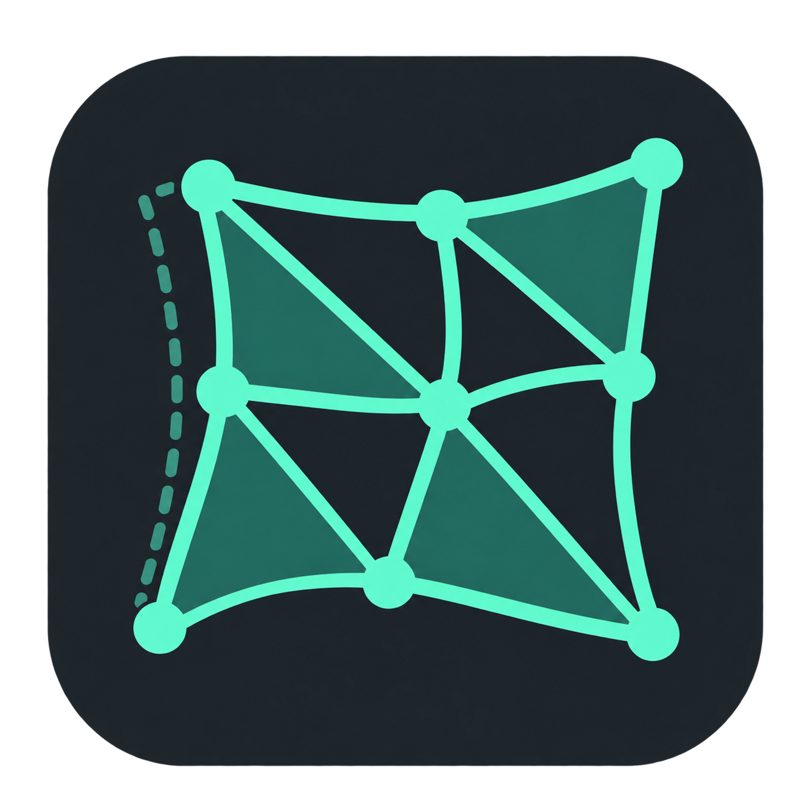
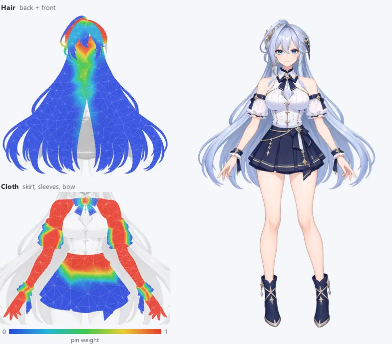
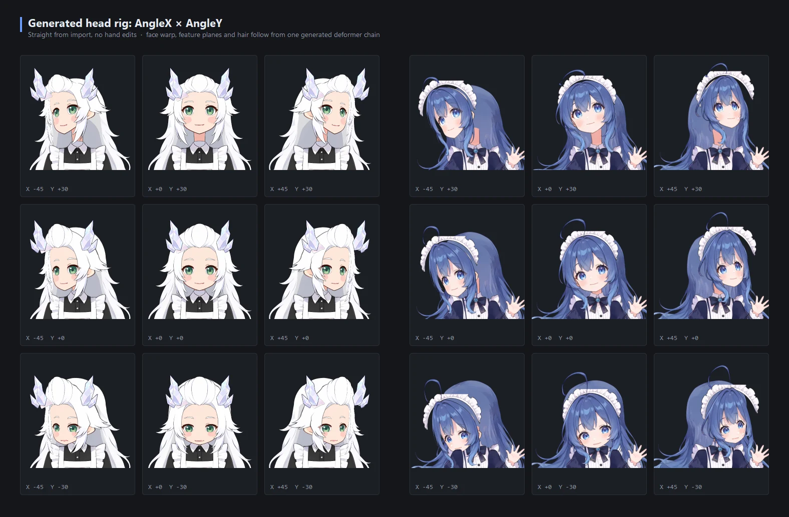
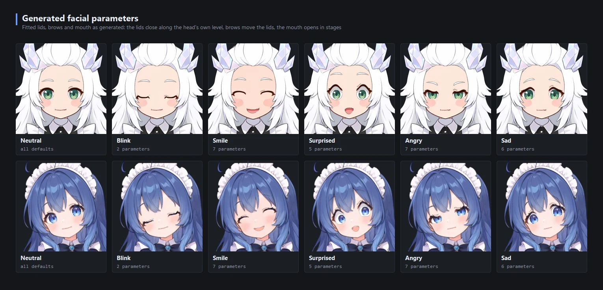

<div align="center">

<!-- lang: zh en ko ja -->
> [中文](README.md) · **English** · [한국어](README.ko.md) · [日本語](README.ja.md)



# PSD2Live

**An open-source 2D character rigging and animation editor**

It builds a movable first version from a layered PSD, then lets you refine shapes, rig a skeleton, set up physics and simulation, and author animation in the same workspace,<br>
then export to Cubism, VTube Studio, the built-in runtime, the web, a game engine, or video.

[](https://github.com/tsunehimatoi/psd2live/releases/latest)
[](#license)
[](#download)
[](#export-and-playback)
[](#connect-an-agent-mcp)

[Download](https://github.com/tsunehimatoi/psd2live/releases/latest) · [Quick start](#quick-start) · [Documentation](docs/en/README.md) · [Changelog](docs/en/CHANGELOG.md) · [Roadmap](docs/en/ROADMAP.md)

</div>

PSD2Live is a complete 2D character-rigging toolchain. It generates meshes, deformers, parameters, motions, and physics from a layered PSD, lets you keep editing them in the desktop editor, and compiles the result to Cubism, the built-in runtime p2lrt, and several general-purpose formats. It has its own evaluation engine, project format, and branch history. One-click generation is the starting point. Every change is stored as a replayable edit and still applies after regeneration.

> [!NOTE]
> Cubism is the primary export target, and it does not define the limit of the editor's capabilities. Features Cubism lacks, such as skeletons and 2D simulation, are baked on export into native deformers, parameters, keyforms, and pendulums. The delivered model does not depend on PSD2Live.

## Who it is for

| You are | What PSD2Live does |
| --- | --- |
| **A beginner who only wants a model that moves** | Name the layers to the convention, import, pick a preset, and in a few minutes get a model with idle, blink, nod, and hair physics. Export it straight to VTube Studio or the web |
| **New to modeling and want to hand the work to AI** | The local MCP server lets agents such as Claude Code and Codex read and edit the project directly. Every step enters the same history, and you can inspect and undo it in the interface |
| **Experienced and want to skip the repetitive work** | Generate meshes, deformer chains, facial parameters, and physics in one step, then refine each item on the canvas. Manual edits are stored as replayable edits and still apply after regeneration |
| **Looking for an open-source alternative** | The editor, the engine, and the project format are all open source. You can edit, preview, and export `.moc3` / `.cmo3` without the official SDK |
| **Past what Cubism itself can do** | Tools Cubism does not have, such as skeletons and IK, 2D cloth and hair simulation, and an automatic skeleton, are baked into native structures on export |
| **Putting the character into your own program** | The open-source Rust runtime p2lrt connects to C / C++, .NET, Android, the web, and Godot, and includes a software renderer. You can also export video, image sequences, and Spine, glTF, and Unity (experimental) |

## Core capabilities

| Module | Capabilities |
| --- | --- |
| **Automatic generation** | Recognizes Chinese, English, Japanese, and Korean layer names. Adaptive meshes, a head-and-body deformer chain, facial parameters, idle / blink / nod / head-shake motions, hair physics, and cloth simulation |
| **Canvas editing** | Seven modes: select, deform, edit, simulate, skeleton, paint, and preview. Deform brushes, mesh-topology editing, layer splits and depth splits, Warp / Rotation, and Glue |
| **Skeleton and simulation** | Automatic skeleton, FK / IK, and preset motions. XPBD cloth and hair simulation. All of it bakes into native Cubism structures |
| **Animation and physics** | Timeline, keyframes, and curves. Visual pendulum editing. Evaluation matches the Cubism Native Framework |
| **Textures** | Atlas packing, per-layer texture density, and optional 2× / 4× upscaling |
| **Compile and export** | Every target compiles from the same neutral rig IR, and each export writes a loss report |
| **p2lrt runtime** | An open-source Rust runtime: a C ABI, a software renderer, a WebAssembly web player, a Godot 4 node, and .NET and Android builds. Pose-by-pose agreement with the editor's evaluation |
| **Agent** | A local MCP server with 180+ public operations. It shares edit commands and history with the interface, and supports atomic batches and dry runs |

## Capability verification

The images below use two PSDs from the [example repository](https://github.com/tsunehimatoi/psd2live-examples) (the knee test and the body-motion animation use a separate long-legged character project). Both examples use the "Full" preset on import and have no manual edits. Hair and skirt are baked simulation. Test images are produced from developer tools and command-line export results. Interface screenshots are rendered frames from the real editor window.

### Editor

<table>
<tr>
<td width="50%" valign="top"><br><sub><b>Animation</b>: motion list, timeline, and curve editing. The preview and parameters stay in sync with the playhead</sub></td>
<td width="50%" valign="top"><br><sub><b>Skeleton</b>: adjust joints on the canvas, and pose with FK / IK</sub></td>
</tr>
<tr>
<td width="50%" valign="top"><br><sub><b>Textures</b>: arrange tiles on the atlas and set texture density per layer</sub></td>
<td width="50%" valign="top"><br><sub><b>Start</b>: pick a preset and drop in a PSD to generate in one step, or create a layout project, or open a recent project</sub></td>
</tr>
</table>

### Physics and simulation

The body angle runs one cycle up and down, one cycle left and right, and one cycle around an ellipse. Hair, skirt, sleeves, and the bow are driven by the baked simulation. They lag behind the rise, fall, and turns, and swing back after the motion stops. On the left are the pin weights of each part: 1 follows the body, 0 is fully free, and values in between pull in proportion.

<p align="center"></p>

<p align="center"></p>

### Automatic rigging

Import produces a complete head and face rig. The face Warp, the facial plane, and hair and body follow are driven by the same generated deformer chain.





### Automatic mesh topology

Meshes are generated from the texture outline. Holes, thin bridges, and tips each form their own loops. Parameters are adjustable at the global level and per layer.


<table>
<tr>
<td width="50%" valign="top"><br><sub><b>Real artwork</b>: the example character's long curls. The outline follows each lock</sub></td>
<td width="50%" valign="top"><br><sub><b>Vertex weights</b>: simulation mode shows and paints pin weights on the same mesh (red is pinned, blue is free)</sub></td>
</tr>
</table>

### Automatic skeleton

Layer tags infer the torso, limbs, and tail. Bones bake into native deformers and keyforms. Knees and elbows are shaped like human joints: the outside pushes out a knee contour, the inside folds, and the rigid thigh segment does not drift with the lower leg. The same set of preset motions fits different body types.


### p2lrt runtime consistency

The Rust runtime replays the editor's reference poses and trajectories one by one. Geometry, physics, and simulation all pass. Four file encodings read back the same result.


## Relationship to Cubism

PSD2Live does not depend on Cubism Editor or the SDK to run, and it stays compatible with the Cubism formats. Each capability falls into one of three tiers by whether it can enter Cubism:

| Tier | Meaning | Examples |
| :---: | --- | --- |
| **Lossless** | Cubism supports it natively, or it only affects editing | Meshes, deformers, parameters, physics, and motions; brushes, splits, and automatic generation |
| **Baked** | Cubism does not have it, but it can be baked into keyforms, parameters, or pendulums | Skeletons and IK, cloth / hair simulation, and swing generation |
| **Runtime only** | It cannot be baked. It takes effect only in the built-in runtime, the web, Godot, and raster export | Planned dynamic lighting and stylized rendering. See the [roadmap](docs/en/ROADMAP.md) |

When you export `.moc3` / `.cmo3`, content in the latter two tiers is downgraded for the target version (Cubism 3.0 – 5.3) and written into the loss report.

## Download

Download the latest version from [Releases](https://github.com/tsunehimatoi/psd2live/releases/latest). Changes in each version are in the [changelog](docs/en/CHANGELOG.md).

| Platform | Packages | Notes |
| --- | --- | --- |
| Windows 10 / 11 x64 | Portable ZIP, EXE | Bundles a Java runtime. Unpack or install, then run. Each also has an `-ffmpeg` build with ffmpeg built in |
| Windows 11 ARM64 | Portable ZIP, EXE | Bundles a Java runtime. Cubism native preview is not included (Live2D does not ship Cubism Core for this platform). Preview uses the PSD2Live runtime |
| Linux x86_64 / arm64 | Deb, tar.gz | Bundles the runtime and Cubism native preview (arm64 uses Live2D's experimental build). Requires X11 / GLX (XWayland works). The tar.gz is for distributions without Deb. After unpacking, run `PSD2Live/bin/PSD2Live` |
| macOS 13 and later | DMG | Bundles a Java runtime. After opening, drag PSD2Live into Applications. Menus are at the top of the screen, and the window buttons are the system buttons. The package architecture matches the Mac that built it. See [Build from source](#build-from-source) for how to build it. When it is not notarized, after downloading it from the network, right-click it in Finder and choose Open |

<details>
<summary>Upgrade, uninstall, and Linux notes</summary>

- **Upgrade**: install into the directory that is already installed. You do not choose a path again. EXE / MSI installs from 3.1.x and earlier are removed automatically, and the original directory is reused.
- **Uninstall**: settings and workspace data are kept by default. Uninstall asks whether to delete PSD2Live's data as well. Choose Yes to delete it. Saved project files, and files you placed in the install directory, are always kept.
- **Linux**: native preview does not support pure Wayland without XWayland, or musl (such as Alpine). Those environments fall back to the built-in renderer automatically. See [Cubism native preview](docs/en/guide/CUBISM_SDK_SETUP.md).

</details>

## Quick start

1. **Import a PSD**: **File → New → New project from PSD…** (`Ctrl+Shift+O`), or drop a PSD into the window. Before import, choose a model preset under "Generate from PSD" on the Start page (Minimal / Default / Full). The property panel on the right can adjust each item. After import, generation runs automatically and you enter editing. Left and right parts drawn on the same layer (such as the left and right legs) are separated with **Model → Check disconnected meshes in the whole model…**.
2. **Check recognition**: in the Layers table, check each layer's part type, side, and variant settings. Correct anything that was recognized wrong.
3. **Preview and edit**: switch to the Preview workspace to check motions and physics, then open the Edit, Rig, Animation, Physics, and Texture workspaces as needed.
4. **Save and export**: `Ctrl+S` saves the `.psd2live` project. `Ctrl+G` exports `.moc3` / `.cmo3`. Other formats are under **File → Export as**.

> [!TIP]
> **The first time you use it, press `F1` and open Tutorials on the Help page.** The in-app tutorial highlights the matching controls and prompts you with your current shortcuts. There are two routes: beginners (19 lessons) and people with Cubism experience (14 lessons). The [quick reference](docs/en/guide/USER_GUIDE.md) is the text version.

### Prepare the artwork

The quality of automatic generation depends mostly on how the PSD is layered:

- Separate the eye white, the pupil, and the upper eyelashes. Keep the part of the pupil that the eyelid covers.
- Provide an open-mouth artwork (or separate the upper teeth, lower teeth, and tongue).
- Separate front hair and back hair, and leave margin in occluded areas.
- Keep the body basically upright. Rasterize layer effects and text beforehand.

The full naming table is in [PSD artwork and naming](docs/en/spec/PSD_LAYER_SPEC.md). Unrecognized layers are kept, and you can assign a type manually in the interface.

## Export and playback

| Destination | Output |
| --- | --- |
| **Cubism Editor** | A `.cmo3` model project, for checking and refining in the official editor |
| **Cubism runtimes** | A `.model3.json` + `.moc3` + textures, physics, motions, and the rest of the file family. Load it from `.model3.json` |
| **VTube Studio** | The `.moc3` file family plus `.vtube.json`. Face tracking maps to the standard parameters, and each motion has one hotkey |
| **Your own program / engine / web page** | A `.p2lrt` model for C / C++, .NET, Unity, Godot, and Android, or a WebGL player page that opens directly in a browser |
| **Images and video** | PNG sequences, sprite sheets, and GIF; APNG, animated WebP, MP4, WebM, and ProRes 4444 (through ffmpeg) |
| **PSD** | A layered PSD of the current pose, or the source PSD including generated layers |
| **Experimental** | Spine 4.2, DragonBones 5.5, and glTF 2.0 can be exported only from the command line. The Unity prefab is under **File → Export as** |

`Ctrl+G` exports the Cubism format. The target version can be 3.0 – 5.3 (5.0 by default). Everything else is under **File → Export as**. See [Export targets](docs/en/spec/EXPORT_TARGETS.md).

> [!IMPORTANT]
> To keep working, save the `.psd2live` project. It contains the original PSD, the artwork, the settings, every edit, and the history branches. The `.psd2live.json` written beside an export is only a diagnostic report. A successful export does not mean the result looks the same in every runtime. Before a formal delivery, check it in the target editor and runtime. The supported range is in [Export targets](docs/en/spec/EXPORT_TARGETS.md).

The built-in renderer needs no official SDK. [Cubism native preview](docs/en/guide/CUBISM_SDK_SETUP.md) is optional, and is used to compare rendering and physics with the official runtime.

## The p2lrt runtime

[`runtime/`](runtime/) is the open-source (MIT) Rust runtime that plays exported `.p2lrt` models. The editor's software preview is evaluated by the same library.

| Item | Description |
| --- | --- |
| **Core evaluation** | Warp / Rotation deformation equivalent to Cubism, blend shapes, Glue, parts and draw order, and opacity and color channels. Pose-by-pose agreement with the editor's evaluation |
| **Physics and motions** | Pendulum physics with physics3.json semantics, including wind and stabilization. Up to 16 motion layers stacked by priority, with events and part / model opacity curves. Fade-in and fade-out match Cubism. Several expressions can be active at once |
| **Procedural behavior** | Blink, breath, eye tracking, and lip sync (optionally driven by audio). The host can stack external parameters (such as face capture) on top of motions |
| **Advanced extensions** | Optional: runtime joint skinning, exact links, and live XPBD cloth and hair with collision. When they are off, the result matches core evaluation bit for bit |
| **Rendering** | The host draws by the draw rules in the header, or calls the built-in software renderer `p2l_render` to draw straight into an RGBA image: every color and opacity blend mode, masks, isolated groups, and culling, matching the editor's reference rasterizer. Per-mesh change flags let the host upload only what changed |
| **Host integration** | One read-only model shared by many instances. Staged updates, part opacity and color overrides, hit areas, logging, and a host memory allocator. An internal error invalidates only that handle and does not abort the host |
| **File format** | `.p2lrt` 2.0: a chunked container. Core chunks correspond one-to-one with moc3, and extension chunks are optional. deflate / zstd compression is supported. The same IR writes identical bytes |
| **How to integrate** | The C / C++ header [`p2l_runtime.h`](runtime/include/p2l_runtime.h) and dynamic / static libraries (usable from Unreal), a .NET P/Invoke binding and a Unity component sample, Android (arm64-v8a, armeabi-v7a, x86_64), a WebAssembly web player, and the Godot 4 node `P2LCharacter` ([`runtime/godot/`](runtime/godot/)). See [Other languages and platforms](runtime/bindings/README.md) (English) |

<table>
<tr>
<td width="50%" align="center"><br><sub>Web player (WebAssembly + WebGL)</sub></td>
<td width="50%" align="center"><br><sub>Godot 4 node</sub></td>
</tr>
</table>

The format and evaluation rules are in [Runtime](docs/en/spec/RUNTIME.md) and [`.p2lrt` 2.0 format](docs/en/spec/P2LRT_V2.md).

## Connect an agent (MCP)

1. The MCP server is on by default. It starts with PSD2Live and listens on `http://127.0.0.1:23871/mcp`. Open **Settings → MCP** (the gear on the right of the title bar) to turn it off, or to set the port, the access token, and the published tool set (Compact by default). The access token is stored in plain text in the local user preferences (Java Preferences).
2. Copy the command or configuration for your host (Claude Code, Codex, or generic JSON). Hosts that only support Stdio use [`tools/mcp_proxy.py`](tools/mcp_proxy.py).
3. Have the agent read the project overview with `workspace_overview` first, and inspect a single object with `workspace_inspect`. For operations that are not listed as tools, look them up with `workspace_list_operations` and call them through `workspace_call`.

Several edits can be committed atomically with `workspace_apply_edits` (all succeed, or none take effect). You can also dry-run them first with `workspace_preview_edits`. The interface is described in [MCP usage and API](docs/en/agent/MCP_AUTHORING.md). Projects that already have an explicit stack can use the [modifier stack guide](docs/en/guide/MODIFIERS.md), which describes the current entry points and the parts that are still unfinished.

> [!NOTE]
> MCP itself does not generate images. Adding new artwork requires the host to be able to generate images. A tool being callable does not mean a complex modeling task is already reliable. The [capability record](docs/en/STATUS.md) records success and failure samples from real tasks.

## Build from source

You need JDK 21 (Windows release packages use JetBrains Runtime 21; see the [development guide](docs/en/guide/DEVELOPMENT.md#environment)). Gradle uses the wrapper shipped in the repository. When Rust is installed (cargo, rustc 1.87 or later), the Rust runtime is built as well. When cargo is missing or rustc is too old, Linux first downloads the prebuilt library that CI built from the same `runtime/` sources (`-Ppsd2live.prebuiltRuntime=false` turns that off). If the download fails, the build skips it and prints a notice, and the editor uses the built-in evaluator (run `rustup update`, then build). On macOS 13 and later, `./gradlew packageDmg` produces a DMG with a runtime. You do not install JBR separately. See the [development guide](docs/en/guide/DEVELOPMENT.md#tests-and-packaging).

```bash
# 启动 GUI（Windows：.\gradlew.bat run 或 run-gui.bat）
./gradlew run

# 命令行直接从 PSD 生成模型
python tools/examples/fetch.py --case tml
./gradlew run --args="--input examples/tml/psd-input/tml.psd --output build/example-output"

# 把工程导出为其他格式，例如 GIF
./gradlew run --args="export model.psd2live --target gif --set clip=Nod"

# 运行测试 / 打当前平台安装包
./gradlew test
./gradlew packageDistributionForCurrentOS
```

A source build uses the built-in renderer by default. The official Cubism SDK has to be obtained separately, and the bridge library is built on its own. Full CLI parameters, packaging, and the native-preview build are in [Development and the command line](docs/en/guide/DEVELOPMENT.md).

## Documentation

| Getting started | Rigging and animation | Reference |
| --- | --- | --- |
| [Quick reference](docs/en/guide/USER_GUIDE.md) | [Skeleton and poses](docs/en/guide/SKELETON.md) | [PSD artwork and naming](docs/en/spec/PSD_LAYER_SPEC.md) |
| [Canvas editing](docs/en/guide/CANVAS_EDITOR.md) | [Swing generation](docs/en/guide/SWING.md) | [Deformers and parameters](docs/en/spec/DEFORMER_AND_PARAMETER_SPEC.md) |
| [Depth split](docs/en/guide/DEPTH_SPLIT.md) | [Physics](docs/en/guide/PHYSICS.md) | [Export targets](docs/en/spec/EXPORT_TARGETS.md) |
| [Texture upscaling](docs/en/guide/TEXTURE_UPSCALE.md) | [Simulation and baking](docs/en/guide/SIMULATION.md) | [Runtime](docs/en/spec/RUNTIME.md) |
| [Deform paths](docs/en/guide/DEFORM_PATHS.md) | [Simulation tutorial](docs/en/guide/SIMULATION_TUTORIAL.md) | [Rig preset architecture](docs/en/spec/RIG_PRESETS.md) |
| [Development and the command line](docs/en/guide/DEVELOPMENT.md) | [MCP usage and API](docs/en/agent/MCP_AUTHORING.md) | [Project format](docs/en/spec/PROJECT_FORMAT.md) · [Document layer](docs/en/spec/DOCUMENT_LAYER.md) |

All documents are in the [documentation catalog](docs/en/README.md). Example artwork, projects, production cases, prompts, and skills are in the [example repository](https://github.com/tsunehimatoi/psd2live-examples). Later directions are in the [roadmap](docs/en/ROADMAP.md).

## Contributing

Issues, reproducible PSDs, documentation fixes, and code improvements are welcome.

Contributions to the [example repository](https://github.com/tsunehimatoi/psd2live-examples/issues/new/choose) are welcome too: artwork, projects, production notes, prompts, or skills. Unfinished or failed attempts are useful as reference as well.

- **Report a problem**: include the version, the operating system, the reproduction steps, the expected and actual results, and the relevant records from the log panel.
- **Submit code**: first run the tests related to the change (`./gradlew test`). A new editing feature has to be saved with the project and replayed after the project is reopened. See [Development and the command line](docs/en/guide/DEVELOPMENT.md).
- **Agent cases**: also record the host, the model, the rework count, and the cost. The format is in the [capability record](docs/en/STATUS.md).

## License

| Part | License |
| --- | --- |
| The application itself, the `umamo` engine, and the Cubism and PSD export targets | [GPL-3.0](LICENSE) |
| The neutral rig IR `format-model`, the export framework `format-compile`, the other export targets, and the Rust runtime `runtime/` | MIT, and they can be reused on their own |

The application as a whole is released under GPL-3.0. Each module's license is in its `LICENSE` and in [Export targets](docs/en/spec/EXPORT_TARGETS.md#modules). Third-party components are in [THIRD_PARTY_NOTICES.md](THIRD_PARTY_NOTICES.md). Terms of use for example artwork are in each artwork's own notes.

<sub>PSD2Live is an independent project. It is not affiliated with or sponsored by Live2D Inc. This repository does not contain or distribute proprietary components of the Live2D Cubism SDK. Live2D and Cubism are trademarks of Live2D Inc.</sub>
