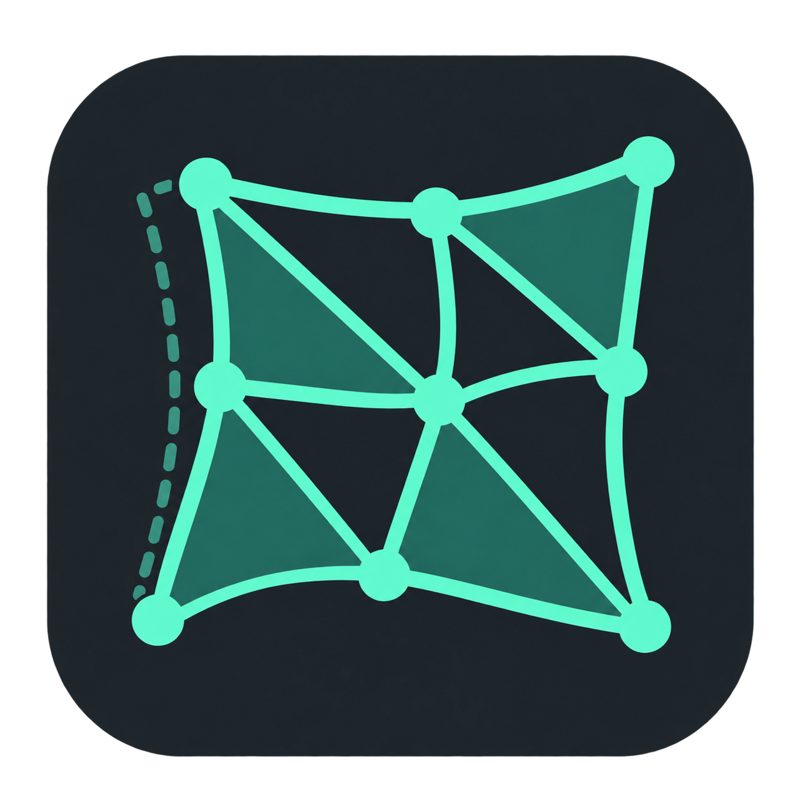
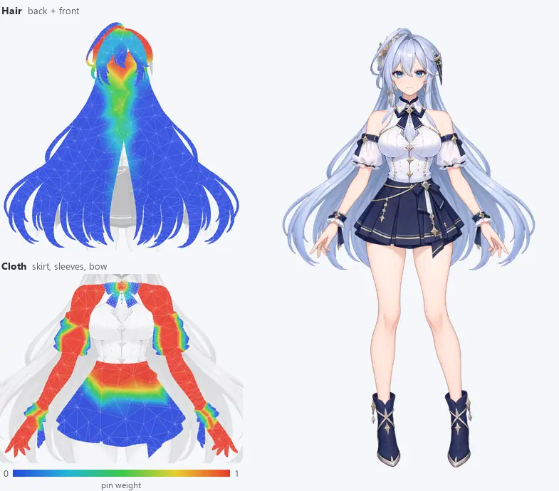
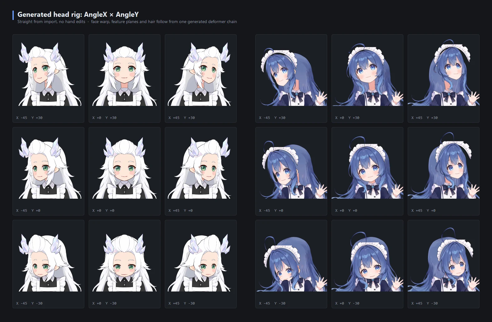
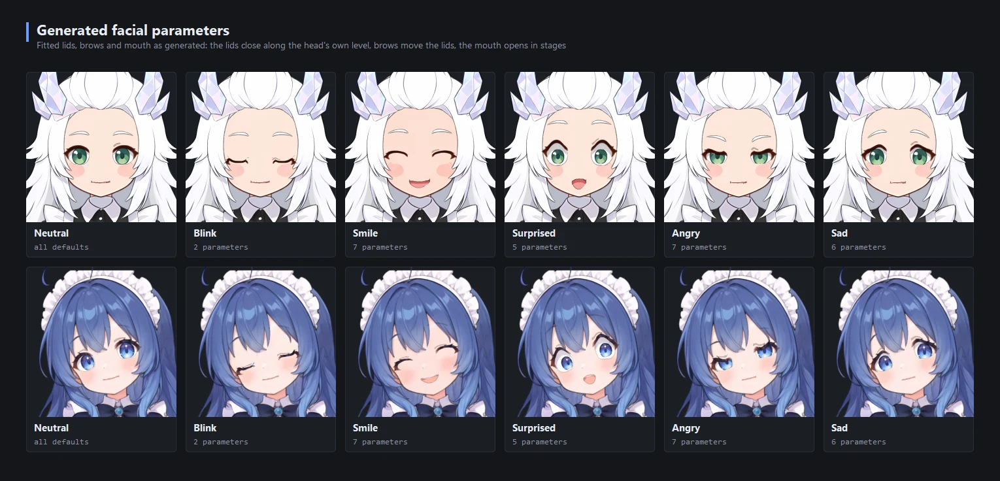

<div align="center">

<!-- lang: zh en ko ja -->
> [中文](README.md) · [English](README.en.md) · [한국어](README.ko.md) · **日本語**



# PSD2Live

**オープンソースの 2D キャラクターリグ・アニメーションエディター**

レイヤー分けされた PSD から動く初版を自動で組み、同じワークスペースで形を直し、ボーンを組み、物理演算とシミュレーションを作り、アニメーションを編集して、<br>
Cubism、VTube Studio、付属ランタイム、ウェブ、ゲームエンジン、または動画へ書き出します。

[](https://github.com/tsunehimatoi/psd2live/releases/latest)
[](#ライセンス)
[](#ダウンロード)
[](#書き出しと再生)
[](#agent-への接続mcp)

[ダウンロード](https://github.com/tsunehimatoi/psd2live/releases/latest) · [クイックスタート](#クイックスタート) · [ドキュメント](docs/ja/README.md) · [更新履歴](docs/ja/CHANGELOG.md) · [ロードマップ](docs/ja/ROADMAP.md)

</div>

PSD2Live は、一連の 2D キャラクターリグ向けツールチェーンです。レイヤー分けされた PSD からメッシュ、デフォーマ、パラメータ、モーション、物理演算を自動生成し、デスクトップエディターで編集を続け、Cubism、付属ランタイム p2lrt、および複数の汎用フォーマットへコンパイルします。独立した評価エンジン、プロジェクト形式、分岐履歴を備えています。ワンクリック生成は出発点にすぎません。すべての変更は再実行できる編集として保存されるため、再生成したあとも有効なままです。

> [!NOTE]
> Cubism は第一の書き出し先であり、能力の上限ではありません。ボーンや 2D シミュレーションなど、Cubism にない機能は、書き出し時にネイティブのデフォーマ、パラメータ、キーフォーム、振り子へベイクされます。納品されるモデルは、PSD2Live に依存しません。

## こんな人に

| あなたは | PSD2Live でできること |
| --- | --- |
| **基礎は不要で、動くモデルがほしい** | 命名規則に沿ってレイヤーを分け、読み込み後にプリセットを選ぶと、数分で待機、まばたき、うなずき、髪の物理演算を備えたモデルが得られ、そのまま VTube Studio やウェブへ書き出せます |
| **モデリングに不慣れで、AI に任せたい** | ローカルの MCP サーバーにより、Claude Code や Codex などの Agent がプロジェクトを直接読み書きできます。各手順は同じ履歴に入り、画面上で確認と取り消しができます |
| **経験があり、繰り返し作業を省きたい** | メッシュ、デフォーマチェーン、顔パーツのパラメータ、物理演算をワンクリックで生成し、キャンバス上で項目ごとに仕上げます。手作業の変更は再実行できる編集として保存され、再生成したあとも有効です |
| **オープンソースの代替が必要** | エディター、エンジン、プロジェクト形式はすべてオープンソースです。公式 SDK がなくても `.moc3` / `.cmo3` を編集、プレビュー、書き出しできます |
| **Cubism の機能では足りない** | ボーンと IK、2D の布と髪のシミュレーション、自動スケルトンなど、Cubism にないツールは、書き出し時にネイティブ構造へベイクされます |
| **キャラクターを自分のプログラムに入れたい** | オープンソースの Rust ランタイム p2lrt。C / C++、.NET、Android、ウェブ、Godot から接続でき、ソフトウェアレンダラーを内蔵します。動画、連番フレーム、Spine、glTF、Unity（実験的）への書き出しもできます |

## 主な能力

| モジュール | 能力 |
| --- | --- |
| **自動生成** | 中国語 / 英語 / 日本語 / 韓国語のレイヤー名を認識します。適応メッシュ、頭身のデフォーマチェーン、顔パーツのパラメータ、待機 / まばたき / うなずき / 首振りのモーション、髪の物理演算と布のシミュレーション |
| **キャンバス編集** | 選択、変形、編集、シミュレーション、ボーン、描画、プレビューの 7 モード。変形ブラシ、メッシュトポロジの編集、レイヤー分割と前後分割、Warp / Rotation、Glue |
| **ボーンとシミュレーション** | 自動スケルトン、FK / IK、プリセットモーション。XPBD による布と髪のシミュレーション。すべてを Cubism のネイティブ構造へベイクします |
| **アニメーションと物理演算** | タイムライン、キーフレーム、カーブ。振り子を可視化して編集し、評価は Cubism Native Framework に揃えます |
| **テクスチャ** | テクスチャアトラスの配置、レイヤーごとのテクスチャ密度、任意の 2× / 4× 高解像度化 |
| **コンパイルと書き出し** | すべての書き出し先は、同じ中立リグ IR からコンパイルし、毎回損失レポートを出力します |
| **p2lrt ランタイム** | オープンソースの Rust ランタイム。C ABI、ソフトウェアレンダラー、WebAssembly ウェブプレーヤー、Godot 4 ノード、.NET と Android 向けビルド。エディターの評価と、ポーズごとに一致します |
| **Agent** | ローカルの MCP サーバー。180 余りの公開操作。画面と同じ編集コマンドと履歴を使い、原子的な一括適用と試行実行に対応します |

## 能力の検証

次の画像は、[サンプルリポジトリ](https://github.com/tsunehimatoi/psd2live-examples) の 2 つの PSD に基づきます（膝のテストと、体の動きのアニメーションは、別の脚の長いキャラクターのプロジェクトを使っています）。2 つのサンプルは、いずれも読み込み時に「フル」プリセットを選び、手作業の修正はしておらず、髪とスカートの裾はベイク後のシミュレーションです。テスト図は開発ツールとコマンドラインの書き出し結果から生成し、画面のスクリーンショットは、実際のエディターウィンドウの描画フレームです。

### エディター

<table>
<tr>
<td width="50%" valign="top"><br><sub><b>アニメーション</b>：モーション一覧、タイムライン、カーブ編集。プレビューとパラメータは再生ヘッドに同期します</sub></td>
<td width="50%" valign="top"><br><sub><b>ボーン</b>：キャンバス上で関節を調整し、FK / IK でポーズを取る</sub></td>
</tr>
<tr>
<td width="50%" valign="top"><br><sub><b>テクスチャ</b>：テクスチャアトラス上にタイルを配置し、レイヤーごとにテクスチャ密度を設定する</sub></td>
<td width="50%" valign="top"><br><sub><b>スタート</b>：プリセットを選んでから PSD をドロップしてワンクリック生成するか、レイヤー読み込みプロジェクトを新規作成するか、最近のプロジェクトを開く</sub></td>
</tr>
</table>

### 物理演算とシミュレーション

体の角度を、上下、左右、楕円に沿った動きの順に、それぞれ 1 周させます。髪、スカート、袖、リボンはベイク後のシミュレーションに引かれ、起伏と向きの変化に遅れて揺れ、止まると戻ります。左側は各パーツの pin ウェイトです。1 は体に追従し、0 は完全に自由、中間値は割合に応じて引きます。

<p align="center"></p>

<p align="center"></p>

### 自動リグ

読み込むだけで、頭部と顔パーツのリグがそろいます。顔の Warp、顔パーツの平面、髪と体の追従は、同じ生成されたデフォーマチェーンが駆動します。





### 自動メッシュのトポロジ

メッシュはテクスチャの輪郭に沿って生成され、穴、細い橋、先端はそれぞれ輪になります。パラメータは、全体とレイヤーごとの 2 段階で調整できます。


<table>
<tr>
<td width="50%" valign="top"><br><sub><b>実際の素材</b>：サンプルキャラクターの長い巻き髪。輪郭が髪の一筋ごとに沿っている</sub></td>
<td width="50%" valign="top"><br><sub><b>頂点ウェイト</b>：シミュレーションモードは同じメッシュ上に固定点ウェイトを表示し、ブラシで描ける（赤が固定、青が自由）</sub></td>
</tr>
</table>

### 自動スケルトン

レイヤーのタグから胴、四肢、尻尾を推定し、ボーンをネイティブのデフォーマとキーフォームへベイクします。膝と肘は人体の関節として成形します。外側は膝の輪郭を押し出し、内側は折りたたみ、太ももの剛体区間は下腿に引きずられません。同じプリセットモーションが、体型の違うキャラクターに合います。


### p2lrt ランタイムの一致

Rust ランタイムは、エディターの参照ポーズと軌跡を 1 つずつ再生します。ジオメトリ、物理演算、シミュレーションはすべて通過し、4 種のファイル符号化は同じ結果を読み出します。


## Cubism との関係

PSD2Live は Cubism Editor や SDK がなくても動作しますが、Cubism 形式との互換は保ちます。各能力は、Cubism に入れるかどうかで 3 段階に分けます。

| 段階 | 意味 | 例 |
| :---: | --- | --- |
| **損失なし** | Cubism がネイティブに対応するか、編集過程にだけ影響する | メッシュ、デフォーマ、パラメータ、物理演算、モーション。ブラシ、分割、自動生成 |
| **ベイク** | Cubism にはないが、キーフォーム、パラメータ、振り子へベイクできる | ボーンと IK、布 / 髪のシミュレーション、スイング生成 |
| **ランタイムのみ** | ベイクできず、付属ランタイム、ウェブ、Godot、ラスター書き出しでのみ有効 | 計画中の動的ライティングとスタイル化レンダリング。[ロードマップ](docs/ja/ROADMAP.md) を参照 |

`.moc3` / `.cmo3` を書き出すとき、あとの 2 段階の内容は対象バージョン（Cubism 3.0 – 5.3）に合わせて下げ、損失レポートへ書きます。

## ダウンロード

[Releases](https://github.com/tsunehimatoi/psd2live/releases/latest) から最新版をダウンロードします。各バージョンの変化は [更新履歴](docs/ja/CHANGELOG.md) を参照してください。

| プラットフォーム | インストーラー | 説明 |
| --- | --- | --- |
| Windows 10 / 11 x64 | ポータブル ZIP、EXE | Java ランタイムを同梱。展開またはインストール後、そのまま実行できます。それぞれに、ffmpeg を内蔵した `-ffmpeg` 版もあります |
| Windows 11 ARM64 | ポータブル ZIP、EXE | Java ランタイムを同梱。Cubism のネイティブプレビューは含みません（Live2D はこのプラットフォームの Cubism Core を提供していません）。プレビューは PSD2Live ランタイムを使います |
| Linux x86_64 / arm64 | Deb、tar.gz | ランタイムと Cubism ネイティブプレビューを同梱（arm64 は Live2D の実験版）。X11 / GLX が必要です（XWayland も使えます）。tar.gz は Deb がないディストリビューション向けで、展開後に `PSD2Live/bin/PSD2Live` を実行します |
| macOS 13 以降 | DMG | Java ランタイムを同梱。開いたあと、PSD2Live を「アプリケーション」へドラッグします。メニューは画面上部にあり、ウィンドウボタンはシステムのものです。パッケージのアーキテクチャは、それを作った Mac と同じです。作り方は [ソースからビルド](#ソースからビルド) を参照してください。公証されていないときは、ネットワークからダウンロードしたあと、Finder で右クリックして開きます |

<details>
<summary>アップグレード、アンインストール、Linux の説明</summary>

- **アップグレード**：インストール済みのディレクトリへインストールし、パスを選び直す必要はありません。3.1.x 以前の EXE / MSI インストールは自動で削除され、元のディレクトリを引き継ぎます。
- **アンインストール**：既定では設定とワークスペースのデータは残します。アンインストール時に、PSD2Live のデータを同時に削除するかを尋ね、「はい」を選ぶと一緒に削除できます。保存済みのプロジェクトファイルと、インストールディレクトリに自分で置いたファイルは、常に残ります。
- **Linux**：ネイティブプレビューは、XWayland のない純粋な Wayland と musl（Alpine など）には対応せず、これらの環境では自動で内蔵レンダリングへ戻ります。詳細は [Cubism Native プレビュー](docs/ja/guide/CUBISM_SDK_SETUP.md) を参照してください。

</details>

## クイックスタート

1. **PSD を読み込む**：**ファイル → 新規作成 → PSD から新規プロジェクト…**（`Ctrl+Shift+O`）、または PSD をウィンドウへドロップします。読み込む前に、スタートページの「PSD から生成」でモデルプリセットを選びます（右側のプロパティパネルで項目ごとに調整できます）（最小 / 標準 / フル）。読み込み後は自動生成され、編集に入ります。同じレイヤーに描かれた左右のパーツ（左右の脚など）は、「モデル → モデル全体の独立メッシュを確認…」で分けます。
2. **認識結果を照合する**：「レイヤー」表で、各レイヤーのパーツ種類、左右、差分の設定を確認し、認識が違うものは直接直します。
3. **プレビューと修正**：「プレビュー」ワークスペースに切り替えてモーションと物理演算を確認し、必要に応じて編集、リグ、アニメーション、物理演算、テクスチャのワークスペースへ入ります。
4. **保存と書き出し**：`Ctrl+S` で `.psd2live` プロジェクトを保存します。`Ctrl+G` で `.moc3` / `.cmo3` を書き出します。他の形式は **ファイル → 書き出し形式** にあります。

> [!TIP]
> **初めて使うときは、`F1` を押してヘルプの「チュートリアル」を開いてください。** プログラム内のチュートリアルは対応するコントロールを強調し、現在のショートカットに合わせて操作を案内します。入門（19 課）と Cubism 経験者（14 課）の 2 つのコースがあります。[操作早見表](docs/ja/guide/USER_GUIDE.md) は、その文章版です。

### 素材の準備

自動生成の品質は、主に PSD のレイヤー分けで決まります。

- 白目、瞳、上まつ毛をレイヤー分けし、瞳はまぶたに隠れる部分を残します。
- 口を開けた素材を用意します（または上の歯、下の歯、舌を分けます）。
- 前髪と後ろ髪を分け、隠れる領域には余裕を残します。
- 体はほぼ正立にし、レイヤー効果と文字はあらかじめラスタライズします。

命名の完全な表は [PSD 素材と命名](docs/ja/spec/PSD_LAYER_SPEC.md) を参照してください。認識されなかったレイヤーは残り、画面上で種類を手動指定できます。

## 書き出しと再生

| 行き先 | 出力 |
| --- | --- |
| **Cubism Editor** | `.cmo3` モデルプロジェクト。公式エディターで確認と仕上げができます |
| **Cubism ランタイム** | `.model3.json` + `.moc3` + テクスチャ、物理演算、モーションなどのファイル一式。`.model3.json` から読み込みます |
| **VTube Studio** | `.moc3` のファイル一式に `.vtube.json` を加え、顔追跡を標準パラメータへ対応付け、各モーションにホットキーを 1 つ付けます |
| **自分のプログラム / エンジン / ウェブ** | `.p2lrt` モデル。C / C++、.NET、Unity、Godot、Android で使うか、ブラウザーで直接開ける WebGL 再生ページにします |
| **画像と動画** | PNG 連番、スプライトシート、GIF。APNG、WebP アニメーション、MP4、WebM、ProRes 4444（ffmpeg 経由） |
| **PSD** | 現在のポーズでレイヤー分け PSD を出力するか、生成レイヤーを含むソース PSD を書き出します |
| **実験的** | Spine 4.2、DragonBones 5.5、glTF 2.0 はコマンドラインからだけ書き出せます。Unity プレハブは **ファイル → 書き出し形式** にあります |

`Ctrl+G` で Cubism 形式を書き出します。対象バージョンは 3.0 – 5.3 から選べます（既定は 5.0）。その他は **ファイル → 書き出し形式** にあります。詳細は [書き出し先](docs/ja/spec/EXPORT_TARGETS.md) を参照してください。

> [!IMPORTANT]
> 作業を続けるときは `.psd2live` プロジェクトを保存してください。元の PSD、素材、設定、すべての編集、履歴の分岐が含まれます。書き出し時に付く `.psd2live.json` は診断レポートにすぎません。書き出しが成功しても、すべてのランタイムで効果が一致するわけではありません。正式に渡す前に、対象のエディターと実行環境で確認してください。対応範囲は [書き出し先](docs/ja/spec/EXPORT_TARGETS.md) を参照してください。

内蔵レンダリングに公式 SDK は不要です。[Cubism Native プレビュー](docs/ja/guide/CUBISM_SDK_SETUP.md) は任意で、公式ランタイムの描画と物理演算を対照するために使います。

## p2lrt ランタイム

[`runtime/`](runtime/) はオープンソース（MIT）の Rust ランタイムで、書き出した `.p2lrt` モデルを再生します。エディターのソフトウェアプレビューも、同じライブラリが評価します。

| 項目 | 説明 |
| --- | --- |
| **コアの評価** | Cubism と等価な Warp / Rotation の変形、ブレンドシェイプ、Glue、パーツと描画順、不透明度と色チャンネル。エディターの評価と、ポーズごとに一致します |
| **物理演算とモーション** | physics3.json の意味に沿った振り子物理。風と安定化を含みます。最大 16 層のモーションを優先度で重ね、イベントとパーツ / 全体の不透明度カーブに対応し、フェードインとフェードアウトは Cubism と同じです。複数の表情を同時に有効にできます |
| **手続き的な挙動** | まばたき、呼吸、視線追従、口の形（音声で駆動できます）。ホスト層は、モーションの上に外部パラメータ（顔トラッキングなど）を重ねられます |
| **高度な拡張** | 任意でオンにできます。関節のランタイムスキニング、精密リンク、XPBD のリアルタイムな布と髪、および衝突。オフのとき、結果はコアの評価とビットごとに一致します |
| **レンダリング** | ホストはヘッダー内の描画規則に従って自分で描くか、内蔵ソフトウェアレンダラー `p2l_render` を呼んで RGBA 画像へ直接描きます。すべての色と不透明度のブレンドモード、マスク、隔離グループ、カリングは、エディターの参照ラスタライザーと一致します。メッシュごとの変化フラグにより、ホストは変わった部分だけをアップロードできます |
| **ホストへの組み込み** | 1 つの読み取り専用モデルを、複数のインスタンスで共有できます。段階的な更新、パーツの不透明度と色の上書き、クリック領域、ログ、ホストのメモリアロケーター。内部エラーはそのハンドルだけを無効にし、ホストは中断しません |
| **ファイル形式** | `.p2lrt` 2.0。チャンクコンテナで、コアチャンクは moc3 と一対一に対応し、拡張チャンクは任意です。deflate / zstd 圧縮に対応し、同じ IR はバイト単位で同じものを書き出します |
| **接続方法** | C / C++ ヘッダー [`p2l_runtime.h`](runtime/include/p2l_runtime.h) と、動的 / 静的ライブラリ（Unreal でも使えます）、.NET の P/Invoke バインディングと Unity コンポーネントの例、Android（arm64-v8a、armeabi-v7a、x86_64）、WebAssembly ウェブプレーヤー、Godot 4 ノード `P2LCharacter`（[`runtime/godot/`](runtime/godot/)）。[その他の言語とプラットフォーム](runtime/bindings/README.md)（英語）を参照してください |

<table>
<tr>
<td width="50%" align="center"><br><sub>ウェブプレーヤー（WebAssembly + WebGL）</sub></td>
<td width="50%" align="center"><br><sub>Godot 4 ノード</sub></td>
</tr>
</table>

形式と評価の規則は [ランタイム](docs/ja/spec/RUNTIME.md) と [`.p2lrt` 2.0 形式](docs/ja/spec/P2LRT_V2.md) を参照してください。

## Agent への接続（MCP）

1. MCP サーバーは既定でオンになり、PSD2Live の起動とともに `http://127.0.0.1:23871/mcp` を待ち受けます。**設定 → MCP**（タイトルバー右側の歯車）でオフにするか、ポート、アクセストークン、公開するツールセット（既定は簡略）を設定できます。アクセストークンは、ローカルのユーザー設定（Java Preferences）に平文で保存されます。
2. 自分のホストに対応するコマンドまたは設定をコピーします（Claude Code、Codex、汎用 JSON）。Stdio だけに対応するホストは [`tools/mcp_proxy.py`](tools/mcp_proxy.py) を使います。
3. Agent には、先に `workspace_overview` でプロジェクトの概要を読ませ、`workspace_inspect` で単一のオブジェクトを見させます。ツールとして列挙されていない操作は、`workspace_list_operations` で探し、`workspace_call` 経由で呼びます。

複数の編集は `workspace_apply_edits` で原子的に確定できます（すべて成功するか、すべて無効）。先に `workspace_preview_edits` で試行実行することもできます。インターフェースの説明は [MCP の使い方とインターフェース](docs/ja/agent/MCP_AUTHORING.md) を参照してください。明示的なスタックがすでにあるプロジェクトは [モディファイアスタックのガイド](docs/ja/guide/MODIFIERS.md) を参照してください。現在の入口と、まだ終わっていない部分が説明されています。

> [!NOTE]
> MCP 自体は画像を生成しません。新しい素材には、ホスト側の画像生成能力が必要です。ツールを呼び出せることは、複雑なモデリング作業がすでに信頼できることを意味しません。[能力の実測](docs/ja/STATUS.md) には、実際のタスクの成功と失敗のサンプルが記録されています。

## ソースからビルド

JDK 21 が必要です（Windows の配布パッケージは JetBrains Runtime 21 を使います。[開発ガイド](docs/ja/guide/DEVELOPMENT.md#環境) を参照）。Gradle は、リポジトリ同梱の Wrapper を使います。Rust（cargo、rustc 1.87 以上）が入っているときは、Rust ランタイムも同時にビルドします。cargo がない、または rustc が古すぎるときは、Linux は先に、CI が同じ `runtime/` ソースからビルドしたプリビルドライブラリをダウンロードします（`-Ppsd2live.prebuiltRuntime=false` でオフにできます）。ダウンロードできないときはスキップして案内を出し、エディターは内蔵の評価器を使います（`rustup update` のあとビルドできます）。macOS 13 以降では `./gradlew packageDmg` で、ランタイム付きの DMG を作ります。JBR を別途インストールする必要はありません。説明は [開発ガイド](docs/ja/guide/DEVELOPMENT.md#テストとパッケージング) を参照してください。

```bash
# 启动 GUI（Windows：.\gradlew.bat run 或 run-gui.bat）
./gradlew run

# 命令行直接从 PSD 生成模型
python tools/examples/fetch.py --case tml
./gradlew run --args="--input examples/tml/psd-input/tml.psd --output build/example-output"

# 把工程导出为其他格式，例如 GIF
./gradlew run --args="export model.psd2live --target gif --set clip=Nod"

# 运行测试 / 打当前平台安装包
./gradlew test
./gradlew packageDistributionForCurrentOS
```

ソースビルドは、既定で内蔵レンダリングを使います。公式の Cubism SDK は自分で入手し、ブリッジライブラリを別にビルドする必要があります。CLI 引数の全体、パッケージ方法、ネイティブプレビューのビルドは [開発とコマンドライン](docs/ja/guide/DEVELOPMENT.md) を参照してください。

## ドキュメント

| はじめに | リグとアニメーション | 参考 |
| --- | --- | --- |
| [操作早見表](docs/ja/guide/USER_GUIDE.md) | [ボーンとポーズ](docs/ja/guide/SKELETON.md) | [PSD 素材と命名](docs/ja/spec/PSD_LAYER_SPEC.md) |
| [キャンバス編集](docs/ja/guide/CANVAS_EDITOR.md) | [スイング生成](docs/ja/guide/SWING.md) | [デフォーマとパラメータ](docs/ja/spec/DEFORMER_AND_PARAMETER_SPEC.md) |
| [前後分割](docs/ja/guide/DEPTH_SPLIT.md) | [物理演算](docs/ja/guide/PHYSICS.md) | [書き出し先](docs/ja/spec/EXPORT_TARGETS.md) |
| [テクスチャ高解像度化](docs/ja/guide/TEXTURE_UPSCALE.md) | [シミュレーションとベイク](docs/ja/guide/SIMULATION.md) | [ランタイム](docs/ja/spec/RUNTIME.md) |
| [変形パス](docs/ja/guide/DEFORM_PATHS.md) | [シミュレーション図解チュートリアル](docs/ja/guide/SIMULATION_TUTORIAL.md) | [リグプリセットのアーキテクチャ](docs/ja/spec/RIG_PRESETS.md) |
| [開発とコマンドライン](docs/ja/guide/DEVELOPMENT.md) | [MCP の使い方とインターフェース](docs/ja/agent/MCP_AUTHORING.md) | [プロジェクト形式](docs/ja/spec/PROJECT_FORMAT.md) · [ドキュメント層](docs/ja/spec/DOCUMENT_LAYER.md) |

すべてのドキュメントは [ドキュメント目次](docs/ja/README.md)、サンプル素材、プロジェクト、制作事例、Prompt、Skill は [サンプルリポジトリ](https://github.com/tsunehimatoi/psd2live-examples)、今後の方向は [ロードマップ](docs/ja/ROADMAP.md) を参照してください。

## 貢献

Issue、再現できる PSD、ドキュメントの修正、コードの改善を歓迎します。

[サンプルリポジトリへの投稿](https://github.com/tsunehimatoi/psd2live-examples/issues/new/choose) も歓迎します。素材、プロジェクト、制作の経験、Prompt、Skill を共有してください。未完成や失敗した試みにも、参照する価値があります。

- **問題の報告**：バージョン、オペレーティングシステム、再現手順、期待と実際の結果、ログパネルの関連記録を添付してください。
- **コードの提出**：先に、変更に関係するテストを実行します（`./gradlew test`）。新しい編集機能は、プロジェクトとともに保存でき、開き直したあとに再実行できる必要があります。[開発とコマンドライン](docs/ja/guide/DEVELOPMENT.md) を参照してください。
- **Agent の事例**：ホスト、モデル、手戻りの回数、消費を同時に記録してください。形式は [能力の実測](docs/ja/STATUS.md) を参照してください。

## ライセンス

| 部分 | ライセンス |
| --- | --- |
| アプリ本体、エンジン `umamo`、Cubism と PSD の書き出し先 | [GPL-3.0](LICENSE) |
| 中立リグ IR `format-model`、書き出しフレームワーク `format-compile`、その他の書き出し先、Rust ランタイム `runtime/` | MIT。単独で再利用できます |

アプリ全体は GPL-3.0 で公開します。各モジュールのライセンスは、その `LICENSE` と [書き出し先](docs/ja/spec/EXPORT_TARGETS.md#モジュール) を参照してください。サードパーティコンポーネントは [THIRD_PARTY_NOTICES.md](THIRD_PARTY_NOTICES.md)、サンプル素材の利用条件はそれぞれの説明を参照してください。

<sub>PSD2Live は独立したプロジェクトであり、Live2D Inc. との所属関係やスポンサー関係はありません。このリポジトリは、Live2D Cubism SDK の専有コンポーネントを含まず、配布もしません。Live2D と Cubism は、Live2D Inc. の商標です。</sub>
