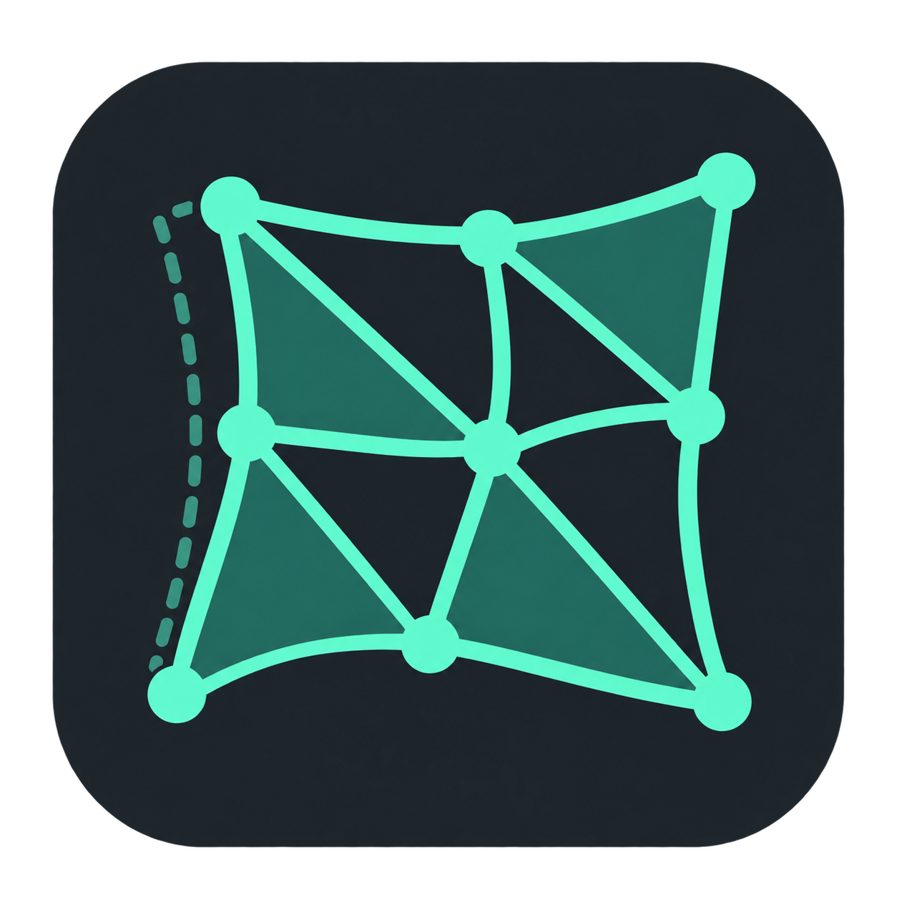
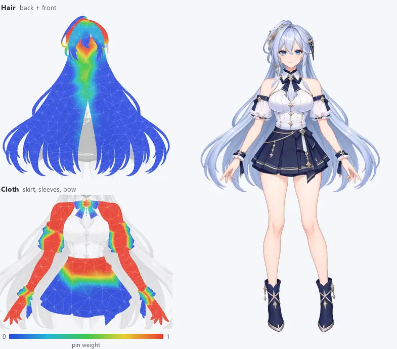
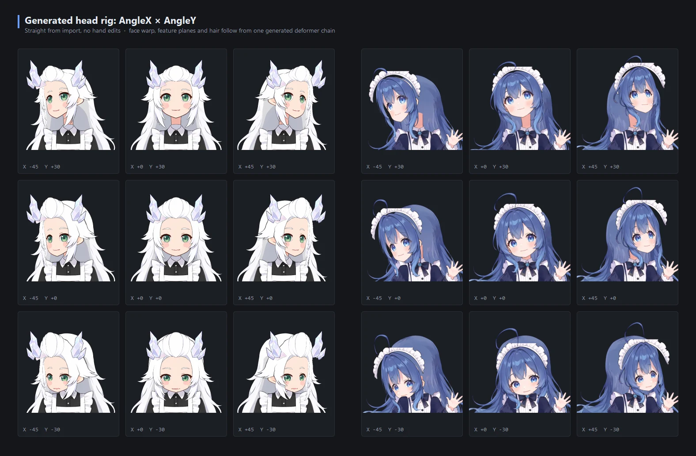
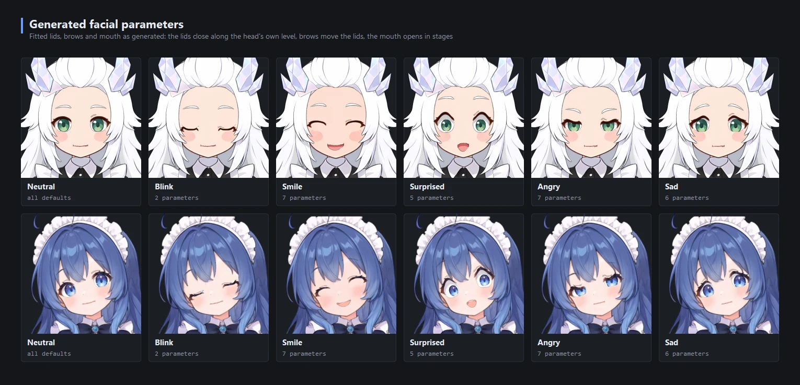

<div align="center">

<!-- lang: zh en ko ja -->
> [中文](README.md) · [English](README.en.md) · **한국어** · [日本語](README.ja.md)



# PSD2Live

**오픈 소스 2D 캐릭터 리깅·애니메이션 편집기**

레이어로 나눈 PSD에서 움직일 수 있는 초안을 자동으로 만들고, 같은 작업 공간에서 형태를 다듬고 스켈레톤을 묶고 물리와 시뮬레이션을 설정하고 애니메이션을 만든 뒤,<br>
Cubism, VTube Studio, 자체 런타임, 웹, 게임 엔진, 영상으로 내보냅니다.

[](https://github.com/tsunehimatoi/psd2live/releases/latest)
[](#라이선스)
[](#다운로드)
[](#내보내기와-재생)
[](#agent-연결mcp)

[다운로드](https://github.com/tsunehimatoi/psd2live/releases/latest) · [빠른 시작](#빠른-시작) · [문서](docs/ko/README.md) · [변경 이력](docs/ko/CHANGELOG.md) · [로드맵](docs/ko/ROADMAP.md)

</div>

PSD2Live는 완전한 2D 캐릭터 리그 도구 모음입니다. 레이어 PSD에서 메시, 디포머, 파라미터, 모션, 물리를 자동으로 만들고, 데스크톱 편집기에서 이어서 수정한 뒤 Cubism, 자체 런타임 p2lrt, 여러 범용 형식으로 컴파일합니다. 독립된 평가 엔진, 프로젝트 형식, 분기 히스토리를 갖습니다. 원클릭 생성은 시작점일 뿐이며, 모든 수정은 재생할 수 있는 편집으로 저장되어 다시 생성한 뒤에도 유효합니다.

> [!NOTE]
> Cubism은 우선적인 내보내기 대상입니다. 이 도구가 할 수 있는 일의 한계는 아닙니다. 스켈레톤, 2D 시뮬레이션처럼 Cubism에 없는 기능은 내보낼 때 네이티브 디포머, 파라미터, 키폼, 진자로 베이크합니다. 전달되는 모델은 PSD2Live에 의존하지 않습니다.

## 누구를 위한 도구인가

| 사용자 | PSD2Live가 하는 일 |
| --- | --- |
| **기초가 없고, 움직이는 모델만 있으면 됩니다** | 이름 규칙에 맞게 레이어를 나누고, 가져온 뒤 프리셋을 고르면 몇 분 안에 대기, 깜빡임, 끄덕임, 머리카락 물리가 있는 모델이 나옵니다. VTube Studio나 웹으로 바로 내보낼 수 있습니다 |
| **모델링에 익숙하지 않아 AI에 맡기고 싶습니다** | 로컬 MCP 서비스가 Claude Code, Codex 같은 Agent가 프로젝트를 직접 읽고 수정하게 합니다. 모든 단계는 같은 히스토리에 들어가며, 화면에서 확인하고 실행 취소할 수 있습니다 |
| **경험이 있고, 반복 작업을 줄이고 싶습니다** | 메시, 디포머 체인, 이목구비 파라미터, 물리를 한 번에 만든 뒤 캔버스에서 항목별로 다듬습니다. 손으로 한 수정은 재생할 수 있는 편집으로 저장되어 다시 생성한 뒤에도 유효합니다 |
| **오픈 소스 대안이 필요합니다** | 편집기, 엔진, 프로젝트 형식이 모두 오픈 소스입니다. 공식 SDK 없이도 `.moc3` / `.cmo3`를 편집하고 미리 보고 내보낼 수 있습니다 |
| **Cubism의 기능만으로는 부족합니다** | 스켈레톤과 IK, 2D 천과 머리카락 시뮬레이션, 자동 스켈레톤처럼 Cubism에 없는 도구가 있으며, 내보낼 때 네이티브 구조로 베이크합니다 |
| **캐릭터를 자신의 프로그램에 넣어야 합니다** | 오픈 소스 Rust 런타임 p2lrt는 C / C++, .NET, Android, 웹, Godot에 연결할 수 있고 소프트웨어 렌더러를 포함합니다. 영상, 시퀀스 프레임, Spine, glTF, Unity(실험적)로도 내보낼 수 있습니다 |

## 핵심 기능

| 모듈 | 기능 |
| --- | --- |
| **자동 생성** | 중국어 / 영어 / 일본어 / 한국어 레이어 이름을 인식합니다. 적응형 메시, 머리·몸 디포머 체인, 이목구비 파라미터, 대기 / 깜빡임 / 끄덕임 / 고개 흔들기 모션, 머리카락 물리와 천 시뮬레이션을 만듭니다 |
| **캔버스 편집** | 선택, 변형, 편집, 시뮬레이션, 스켈레톤, 페인팅, 미리보기 일곱 모드가 있습니다. 변형 브러시, 메시 토폴로지 편집, 레이어 분할과 앞뒤 분리, Warp / Rotation, Glue를 제공합니다 |
| **스켈레톤과 시뮬레이션** | 자동 스켈레톤, FK / IK, 프리셋 모션을 제공합니다. XPBD 천·머리카락 시뮬레이션을 하며, 모두 Cubism 네이티브 구조로 베이크합니다 |
| **애니메이션과 물리** | 타임라인, 키프레임, 곡선을 제공합니다. 진자를 시각적으로 편집하며, 평가는 Cubism Native Framework와 맞춥니다 |
| **텍스처** | 텍스처 아틀라스 배치, 레이어별 텍스처 밀도, 선택적 2× / 4× 고해상도화를 제공합니다 |
| **컴파일과 내보내기** | 모든 대상이 같은 중립 리그 IR에서 컴파일되며, 매번 손실 보고서를 출력합니다 |
| **p2lrt 런타임** | 오픈 소스 Rust 런타임입니다. C ABI, 소프트웨어 렌더러, WebAssembly 웹 플레이어, Godot 4 노드, .NET과 Android 빌드를 제공합니다. 편집기 평가와 포즈별로 일치합니다 |
| **Agent** | 로컬 MCP 서비스가 180여 개의 공개 조작을 제공합니다. 화면과 편집 명령·히스토리를 공유하며, 원자적 일괄 적용과 시험 실행을 지원합니다 |

## 능력 검증

아래 그림은 [예제 저장소](https://github.com/tsunehimatoi/psd2live-examples)의 PSD 두 점을 바탕으로 합니다(무릎 테스트와 몸 움직임 영상은 다리가 긴 캐릭터 프로젝트를 따로 사용합니다). 두 예제 모두 가져올 때 「전체」 프리셋을 골랐고 손으로 수정하지 않았으며, 머리카락과 치마 자락은 베이크한 시뮬레이션입니다. 테스트 그림은 개발 도구와 명령줄 내보내기 결과로 만들었고, 화면 스크린샷은 실제 편집기 창의 렌더 프레임입니다.

### 편집기

<table>
<tr>
<td width="50%" valign="top"><br><sub><b>애니메이션</b>: 모션 목록, 타임라인, 곡선 편집. 미리보기와 파라미터가 재생 헤드와 함께 움직입니다</sub></td>
<td width="50%" valign="top"><br><sub><b>스켈레톤</b>: 캔버스에서 관절을 조정하고 FK / IK로 포즈를 잡습니다</sub></td>
</tr>
<tr>
<td width="50%" valign="top"><br><sub><b>텍스처</b>: 텍스처 아틀라스에 타일을 배치하고 레이어마다 텍스처 밀도를 정합니다</sub></td>
<td width="50%" valign="top"><br><sub><b>시작</b>: 프리셋을 고른 뒤 PSD를 끌어 한 번에 생성하거나, 배치 프로젝트를 새로 만들거나, 최근 프로젝트를 엽니다</sub></td>
</tr>
</table>

### 물리와 시뮬레이션

몸 각도가 위아래, 좌우, 타원을 따라 한 바퀴씩 움직입니다. 머리카락, 치마, 소매, 리본은 베이크한 시뮬레이션이 이끌며, 오르내림과 방향 전환보다 늦게 흔들리다가 멈추면 되돌아옵니다. 왼쪽은 각 파츠의 pin 가중치입니다. 1은 몸을 따르고, 0은 완전히 자유이며, 그 사이 값은 비율대로 끌어당깁니다.

<p align="center"></p>

<p align="center"></p>

### 자동 리그

가져오는 즉시 머리와 이목구비 리그가 갖춰집니다. 얼굴 Warp, 이목구비 평면, 머리카락과 몸의 따라가기는 같은 생성 디포머 체인이 구동합니다.





### 자동 Mesh 토폴로지

메시는 텍스처 윤곽을 따라 만들어집니다. 구멍, 가는 다리, 뾰족한 끝은 각자 고리를 이루며, 파라미터는 전역과 레이어별 두 단계에서 조절할 수 있습니다.


<table>
<tr>
<td width="50%" valign="top"><br><sub><b>실제 소재</b>: 예제 캐릭터의 긴 곱슬머리. 윤곽이 머리카락 한 가닥마다 놓입니다</sub></td>
<td width="50%" valign="top"><br><sub><b>정점 가중치</b>: 시뮬레이션 모드가 같은 메시에 고정점 가중치를 표시하고 칠합니다(빨강은 고정, 파랑은 자유)</sub></td>
</tr>
</table>

### 자동 스켈레톤

레이어 태그로 몸통, 사지, 꼬리를 추론하고, 본은 네이티브 디포머와 키폼으로 베이크합니다. 무릎과 팔꿈치는 인체 관절 형태로 만듭니다. 바깥쪽은 무릎 윤곽이 밀려 나오고, 안쪽은 접히며, 허벅지의 강체 구간은 종아리를 따라 흘러가지 않습니다. 같은 프리셋 모션이 체형이 다른 캐릭터에도 맞습니다.


### p2lrt 런타임 일치

Rust 런타임이 편집기의 참조 포즈와 궤적을 하나씩 재생합니다. 기하, 물리, 시뮬레이션이 모두 통과하고, 네 가지 파일 인코딩이 같은 결과를 읽습니다.


## Cubism과의 관계

PSD2Live는 Cubism Editor나 SDK 없이 동작하지만, Cubism 형식과 호환을 유지합니다. 각 기능은 Cubism에 들어갈 수 있는지에 따라 세 단계로 나뉩니다.

| 단계 | 의미 | 예 |
| :---: | --- | --- |
| **무손실** | Cubism이 네이티브로 지원하거나, 편집 과정에만 영향을 줍니다 | 메시, 디포머, 파라미터, 물리, 모션. 브러시, 분할, 자동 생성 |
| **베이크** | Cubism에는 없지만 키폼, 파라미터, 진자로 베이크할 수 있습니다 | 스켈레톤과 IK, 천 / 머리카락 시뮬레이션, 스윙 생성 |
| **런타임 전용** | 베이크할 수 없고, 자체 런타임, 웹, Godot, 래스터 내보내기에서만 적용됩니다 | 계획 중인 동적 조명과 스타일화 렌더. [로드맵](docs/ko/ROADMAP.md)을 참조합니다 |

`.moc3` / `.cmo3`로 내보낼 때 뒤의 두 단계 내용은 대상 버전(Cubism 3.0 – 5.3)에 맞게 낮추고, 손실 보고서에 기록합니다.

## 다운로드

[Releases](https://github.com/tsunehimatoi/psd2live/releases/latest)에서 최신 버전을 받습니다. 버전별 변화는 [변경 이력](docs/ko/CHANGELOG.md)을 참조합니다.

| 플랫폼 | 설치 패키지 | 설명 |
| --- | --- | --- |
| Windows 10 / 11 x64 | 포터블 ZIP, EXE | Java 런타임을 포함합니다. 압축을 풀거나 설치한 뒤 바로 실행합니다. 각각 ffmpeg를 내장한 `-ffmpeg` 버전도 있습니다 |
| Windows 11 ARM64 | 포터블 ZIP, EXE | Java 런타임을 포함합니다. Cubism 네이티브 미리보기는 없습니다(Live2D가 이 플랫폼의 Cubism Core를 제공하지 않습니다). 미리보기는 PSD2Live 런타임을 사용합니다 |
| Linux x86_64 / arm64 | Deb, tar.gz | 런타임과 Cubism 네이티브 미리보기를 포함합니다(arm64는 Live2D의 실험 버전). X11 / GLX가 필요합니다(XWayland 사용 가능). tar.gz는 Deb가 없는 배포판용이며, 압축을 푼 뒤 `PSD2Live/bin/PSD2Live`를 실행합니다 |
| macOS 13 이상 | DMG | Java 런타임을 포함합니다. 연 뒤 PSD2Live를 “응용 프로그램”으로 끌어 넣습니다. 메뉴는 화면 위에 있고, 창 버튼은 시스템의 것입니다. 패키지 아키텍처는 그것을 만든 Mac과 같으며, 만드는 방법은 [소스에서 빌드](#소스에서-빌드)를 참조합니다. 공증되지 않았으면 네트워크에서 받은 뒤 Finder에서 오른쪽 클릭으로 엽니다 |

<details>
<summary>업그레이드, 제거, Linux 설명</summary>

- **업그레이드**: 이미 설치된 디렉터리에 설치하며, 경로를 다시 고르지 않습니다. 3.1.x 이전의 EXE / MSI 설치는 자동으로 제거되고 원래 디렉터리를 그대로 씁니다.
- **제거**: 기본적으로 설정과 작업 공간 데이터를 남깁니다. 제거할 때 PSD2Live 데이터도 지울지 묻습니다. 「예」를 고르면 함께 지웁니다. 저장한 프로젝트 파일과 설치 디렉터리에 직접 넣어 둔 파일은 항상 남습니다.
- **Linux**: 네이티브 미리보기는 XWayland가 없는 순수 Wayland와 musl(예: Alpine)을 지원하지 않으며, 이런 환경에서는 내장 렌더로 자동 전환합니다. 자세한 내용은 [Cubism Native 미리보기](docs/ko/guide/CUBISM_SDK_SETUP.md)를 참조합니다.

</details>

## 빠른 시작

1. **PSD 가져오기**: **파일 → 새로 만들기 → PSD에서 새 프로젝트…**(`Ctrl+Shift+O`)를 쓰거나, PSD를 창에 끌어 놓습니다. 가져오기 전에 「시작」 페이지의 「PSD에서 생성」에서 모델 프리셋(오른쪽 속성 패널에서 항목별로 조정 가능)을 고릅니다(최소 / 기본 / 전체). 가져온 뒤 자동으로 생성되고 편집으로 들어갑니다. 같은 레이어에 그린 좌우 파츠(예: 좌우 다리)는 「모델 → 모델 전체의 독립 메시 검사…」로 나눕니다.
2. **인식 결과 확인**: 「레이어」 표에서 각 레이어의 파츠 유형, 좌우, 차분 설정을 확인합니다. 잘못 인식된 항목은 바로 고칩니다.
3. **미리보기와 수정**: 「미리보기」 작업 공간에서 모션과 물리를 확인한 뒤, 필요하면 편집, 리그, 애니메이션, 물리, 텍스처 작업 공간으로 들어갑니다.
4. **저장과 내보내기**: `Ctrl+S`로 `.psd2live` 프로젝트를 저장합니다. `Ctrl+G`로 `.moc3` / `.cmo3`를 내보냅니다. 다른 형식은 **파일 → 다른 형식으로 내보내기**에 있습니다.

> [!TIP]
> **처음 사용할 때는 `F1`로 도움말 페이지의 「튜토리얼」을 여세요.** 프로그램 안 튜토리얼이 해당 컨트롤을 강조하고, 현재 단축키에 맞춰 조작을 안내합니다. 기초가 없는 사람(19과)과 Cubism 경험자(14과) 두 경로가 있습니다. [조작 요약](docs/ko/guide/USER_GUIDE.md)은 그 문자판입니다.

### 소재 준비

자동 생성의 품질은 주로 PSD 레이어 구성에 달립니다.

- 흰자, 눈동자, 윗속눈썹을 나누고, 눈동자는 눈꺼풀에 가려지는 부분까지 남겨 둡니다.
- 입을 벌린 소재를 제공하거나, 윗니, 아랫니, 혀를 나눕니다.
- 앞머리와 뒷머리를 나누고, 가려지는 영역에는 여유를 둡니다.
- 몸은 기본적으로 곧게 세우고, 레이어 효과와 글자는 미리 래스터화합니다.

전체 이름 표는 [PSD 소재와 이름](docs/ko/spec/PSD_LAYER_SPEC.md)을 참조합니다. 인식되지 않은 레이어도 남으며, 화면에서 유형을 직접 지정할 수 있습니다.

## 내보내기와 재생

| 가는 곳 | 출력 |
| --- | --- |
| **Cubism Editor** | `.cmo3` 모델 프로젝트. 공식 편집기에서 확인하고 다듬습니다 |
| **Cubism 런타임** | `.model3.json` + `.moc3` + 텍스처, 물리, 모션 등의 파일 묶음. `.model3.json`에서 불러옵니다 |
| **VTube Studio** | `.moc3` 파일 묶음과 `.vtube.json`. 얼굴 추적을 표준 파라미터에 매핑하고, 모션마다 핫키를 둡니다 |
| **자신의 프로그램 / 엔진 / 웹** | `.p2lrt` 모델. C / C++, .NET, Unity, Godot, Android에 쓰거나, 브라우저에서 바로 여는 WebGL 재생 페이지로 씁니다 |
| **이미지와 영상** | PNG 시퀀스 프레임, 스프라이트 시트, GIF. APNG, WebP 애니메이션, MP4, WebM, ProRes 4444(ffmpeg 경유) |
| **PSD** | 현재 포즈의 레이어 PSD를 출력하거나, 생성 레이어가 포함된 원본 PSD를 내보냅니다 |
| **실험적** | Spine 4.2, DragonBones 5.5, glTF 2.0은 명령줄로만 내보냅니다. Unity 프리팹은 **파일 → 다른 형식으로 내보내기**에 있습니다 |

`Ctrl+G`는 Cubism 형식을 내보내며, 대상 버전은 3.0 – 5.3에서 고릅니다(기본 5.0). 나머지는 **파일 → 다른 형식으로 내보내기**에 있습니다. 자세한 내용은 [내보내기 대상](docs/ko/spec/EXPORT_TARGETS.md)을 참조합니다.

> [!IMPORTANT]
> 이어서 작업하려면 `.psd2live` 프로젝트를 저장하세요. 원본 PSD, 소재, 설정, 모든 편집과 히스토리 분기가 들어 있습니다. 내보낼 때 함께 나오는 `.psd2live.json`은 진단 보고서일 뿐입니다. 내보내기에 성공해도 모든 런타임에서 효과가 같다는 뜻은 아닙니다. 정식으로 넘기기 전에 대상 편집기와 실행 환경에서 확인하세요. 지원 범위는 [내보내기 대상](docs/ko/spec/EXPORT_TARGETS.md)을 참조합니다.

내장 렌더는 공식 SDK가 필요 없습니다. [Cubism Native 미리보기](docs/ko/guide/CUBISM_SDK_SETUP.md)는 선택 사항이며, 공식 런타임의 렌더와 물리를 대조할 때 씁니다.

## p2lrt 런타임

[`runtime/`](runtime/)는 오픈 소스(MIT) Rust 런타임이며, 내보낸 `.p2lrt` 모델을 재생합니다. 편집기의 소프트웨어 미리보기도 같은 라이브러리가 평가합니다.

| 항목 | 설명 |
| --- | --- |
| **핵심 평가** | Cubism과 같은 Warp / Rotation 변형, 블렌드 셰이프, Glue, 파츠와 그리기 순서, 투명도와 색 채널. 편집기 평가와 포즈별로 일치합니다 |
| **물리와 모션** | physics3.json 의미의 진자 물리. 바람과 안정을 포함합니다. 최대 16층의 모션을 우선순위로 겹치며, 이벤트와 파츠 / 전체 투명도 곡선을 지원합니다. 페이드 인·아웃은 Cubism과 같습니다. 여러 표정을 동시에 적용할 수 있습니다 |
| **절차적 동작** | 깜빡임, 호흡, 시선 따라가기, 립싱크(오디오로 구동 가능). 호스트 층은 모션 위에 외부 파라미터(예: 페이스 트래킹)를 겹칠 수 있습니다 |
| **고급 확장** | 선택적으로 켭니다. 관절 런타임 스키닝, 정밀 링크, XPBD 실시간 천·머리카락과 충돌. 끄면 결과가 핵심 평가와 비트 단위로 일치합니다 |
| **렌더** | 호스트가 헤더의 그리기 규칙대로 직접 그리거나, 내장 소프트웨어 렌더러 `p2l_render`로 RGBA 이미지에 바로 그립니다. 모든 색·투명도 블렌드 모드, 마스크, 격리 그룹, 컬링이 편집기의 참조 래스터라이저와 같습니다. 메시별 변경 플래그로 호스트는 바뀐 부분만 올립니다 |
| **호스트 통합** | 읽기 전용 모델 하나를 여러 인스턴스가 공유합니다. 단계별 업데이트, 파츠 투명도와 색 덮어쓰기, 클릭 영역, 로그, 호스트 메모리 할당기를 제공합니다. 내부 오류는 해당 핸들만 무효로 하며 호스트를 중단하지 않습니다 |
| **파일 형식** | `.p2lrt` 2.0: 청크 컨테이너. 핵심 블록은 moc3와 일대일이고, 확장 블록은 선택입니다. deflate / zstd 압축을 지원하며, 같은 IR은 바이트가 완전히 같게 씁니다 |
| **연결 방법** | C / C++ 헤더 [`p2l_runtime.h`](runtime/include/p2l_runtime.h)와 동적 / 정적 라이브러리(Unreal에도 사용 가능), .NET P/Invoke 바인딩과 Unity 컴포넌트 예제, Android(arm64-v8a, armeabi-v7a, x86_64), WebAssembly 웹 플레이어, Godot 4 노드 `P2LCharacter`([`runtime/godot/`](runtime/godot/)). [다른 언어와 플랫폼](runtime/bindings/README.md)(영어)을 참조합니다 |

<table>
<tr>
<td width="50%" align="center"><br><sub>웹 플레이어(WebAssembly + WebGL)</sub></td>
<td width="50%" align="center"><br><sub>Godot 4 노드</sub></td>
</tr>
</table>

형식과 평가 규칙은 [런타임](docs/ko/spec/RUNTIME.md)과 [`.p2lrt` 2.0 형식](docs/ko/spec/P2LRT_V2.md)을 참조합니다.

## Agent 연결(MCP)

1. MCP 서비스는 기본적으로 켜져 있으며, PSD2Live가 시작되면 `http://127.0.0.1:23871/mcp`를 수신합니다. **설정 → MCP**(제목 표시줄 오른쪽 톱니바퀴)에서 끄거나, 포트, 액세스 토큰, 게시할 도구 집합(기본은 간결)을 설정합니다. 액세스 토큰은 이 컴퓨터의 사용자 환경설정(Java Preferences)에 평문으로 저장됩니다.
2. 호스트에 맞는 명령이나 설정을 복사합니다(Claude Code, Codex, 범용 JSON). Stdio만 지원하는 호스트는 [`tools/mcp_proxy.py`](tools/mcp_proxy.py)를 사용합니다.
3. Agent에게 먼저 `workspace_overview`로 프로젝트 개요를 읽고, `workspace_inspect`로 개별 객체를 보게 합니다. 도구로 나열되지 않은 조작은 `workspace_list_operations`로 찾고 `workspace_call`로 호출합니다.

여러 편집은 `workspace_apply_edits`로 원자적으로 제출할 수 있습니다(모두 성공하거나 모두 적용되지 않음). `workspace_preview_edits`로 먼저 시험 실행할 수도 있습니다. 인터페이스 설명은 [MCP 사용과 인터페이스](docs/ko/agent/MCP_AUTHORING.md)를 참조합니다. 명시적 스택이 이미 있는 프로젝트는 [모디파이어 스택 가이드](docs/ko/guide/MODIFIERS.md)를 참조합니다. 현재 진입점과 아직 끝나지 않은 부분을 설명합니다.

> [!NOTE]
> MCP 자체는 이미지를 만들지 않습니다. 새 소재를 넣으려면 호스트에 이미지 생성 능력이 있어야 합니다. 도구를 호출할 수 있다고 해서 복잡한 모델링 작업이 이미 안정적이라는 뜻은 아닙니다. [능력 실측](docs/ko/STATUS.md)에 실제 작업의 성공과 실패 표본이 있습니다.

## 소스에서 빌드

JDK 21이 필요합니다(Windows 배포 패키지는 JetBrains Runtime 21을 사용합니다. [개발 가이드](docs/ko/guide/DEVELOPMENT.md#환경)를 참조). Gradle은 저장소에 포함된 Wrapper를 사용합니다. Rust(cargo, rustc 1.87 이상)가 설치되어 있으면 Rust 런타임도 함께 빌드합니다. cargo가 없거나 rustc가 너무 오래되었으면, Linux는 먼저 CI가 같은 `runtime/` 소스로 빌드한 사전 컴파일 라이브러리를 받습니다(`-Ppsd2live.prebuiltRuntime=false`로 끌 수 있습니다). 받지 못하면 건너뛰고 안내를 보여 주며, 편집기는 내장 평가기를 사용합니다(`rustup update` 뒤에 빌드할 수 있습니다). macOS 13 이상은 `./gradlew packageDmg`로 런타임이 포함된 DMG를 만듭니다. JBR을 따로 설치할 필요는 없습니다. 설명은 [개발 가이드](docs/ko/guide/DEVELOPMENT.md#테스트와-패키징)를 참조합니다.

```bash
# 启动 GUI（Windows：.\gradlew.bat run 或 run-gui.bat）
./gradlew run

# 命令行直接从 PSD 生成模型
python tools/examples/fetch.py --case tml
./gradlew run --args="--input examples/tml/psd-input/tml.psd --output build/example-output"

# 把工程导出为其他格式，例如 GIF
./gradlew run --args="export model.psd2live --target gif --set clip=Nod"

# 运行测试 / 打当前平台安装包
./gradlew test
./gradlew packageDistributionForCurrentOS
```

소스 빌드는 기본적으로 내장 렌더를 사용합니다. 공식 Cubism SDK는 직접 받아 브리지 라이브러리를 따로 빌드해야 합니다. 전체 CLI 인자, 패키징 방법, 네이티브 미리보기 빌드는 [개발과 명령줄](docs/ko/guide/DEVELOPMENT.md)을 참조합니다.

## 문서

| 시작하기 | 리그와 애니메이션 | 참고 |
| --- | --- | --- |
| [조작 요약](docs/ko/guide/USER_GUIDE.md) | [스켈레톤과 자세](docs/ko/guide/SKELETON.md) | [PSD 소재와 이름](docs/ko/spec/PSD_LAYER_SPEC.md) |
| [캔버스 편집](docs/ko/guide/CANVAS_EDITOR.md) | [스윙 생성](docs/ko/guide/SWING.md) | [디포머와 파라미터](docs/ko/spec/DEFORMER_AND_PARAMETER_SPEC.md) |
| [앞뒤 분리](docs/ko/guide/DEPTH_SPLIT.md) | [물리](docs/ko/guide/PHYSICS.md) | [내보내기 대상](docs/ko/spec/EXPORT_TARGETS.md) |
| [텍스처 고해상도화](docs/ko/guide/TEXTURE_UPSCALE.md) | [시뮬레이션과 베이크](docs/ko/guide/SIMULATION.md) | [런타임](docs/ko/spec/RUNTIME.md) |
| [디폼 경로](docs/ko/guide/DEFORM_PATHS.md) | [시뮬레이션 그림 튜토리얼](docs/ko/guide/SIMULATION_TUTORIAL.md) | [Rig 프리셋 아키텍처](docs/ko/spec/RIG_PRESETS.md) |
| [개발과 명령줄](docs/ko/guide/DEVELOPMENT.md) | [MCP 사용과 인터페이스](docs/ko/agent/MCP_AUTHORING.md) | [프로젝트 형식](docs/ko/spec/PROJECT_FORMAT.md) · [문서 레이어](docs/ko/spec/DOCUMENT_LAYER.md) |

전체 문서는 [문서 목록](docs/ko/README.md)을 참조합니다. 예제 소재, 프로젝트, 제작 사례, Prompt, Skill은 [예제 저장소](https://github.com/tsunehimatoi/psd2live-examples)에 있습니다. 이후 방향은 [로드맵](docs/ko/ROADMAP.md)을 참조합니다.

## 기여

Issue, 재현 가능한 PSD, 문서 수정, 코드 개선을 환영합니다.

[예제 저장소에 기고](https://github.com/tsunehimatoi/psd2live-examples/issues/new/choose)하는 것도 환영합니다. 소재, 프로젝트, 제작 경험, Prompt, Skill을 공유해 주세요. 끝나지 않았거나 실패한 시도도 참고가 됩니다.

- **문제 보고**: 버전, 운영체제, 재현 단계, 기대한 결과와 실제 결과, 로그 패널의 관련 기록을 첨부합니다.
- **코드 제출**: 변경과 관련된 테스트를 먼저 실행합니다(`./gradlew test`). 새 편집 기능은 프로젝트와 함께 저장되고 다시 연 뒤 재생되어야 합니다. [개발과 명령줄](docs/ko/guide/DEVELOPMENT.md)을 참조합니다.
- **Agent 사례**: 호스트, 모델, 재작업 횟수, 소모를 함께 기록합니다. 형식은 [능력 실측](docs/ko/STATUS.md)을 참조합니다.

## 라이선스

| 부분 | 라이선스 |
| --- | --- |
| 애플리케이션 자체, 엔진 `umamo`, Cubism과 PSD 내보내기 대상 | [GPL-3.0](LICENSE) |
| 중립 리그 IR `format-model`, 내보내기 프레임워크 `format-compile`, 그 밖의 내보내기 대상, Rust 런타임 `runtime/` | MIT. 따로 재사용할 수 있습니다 |

애플리케이션 전체는 GPL-3.0으로 배포합니다. 모듈별 라이선스는 각 `LICENSE`와 [내보내기 대상](docs/ko/spec/EXPORT_TARGETS.md#모듈)을 참조합니다. 서드파티 구성 요소는 [THIRD_PARTY_NOTICES.md](THIRD_PARTY_NOTICES.md)를 참조합니다. 예제 소재의 이용 조건은 각 설명을 참조합니다.

<sub>PSD2Live는 독립 프로젝트이며, Live2D Inc.와 소속이나 후원 관계가 없습니다. 이 저장소는 Live2D Cubism SDK의 독점 구성 요소를 포함하거나 배포하지 않습니다. Live2D와 Cubism은 Live2D Inc.의 상표입니다.</sub>
