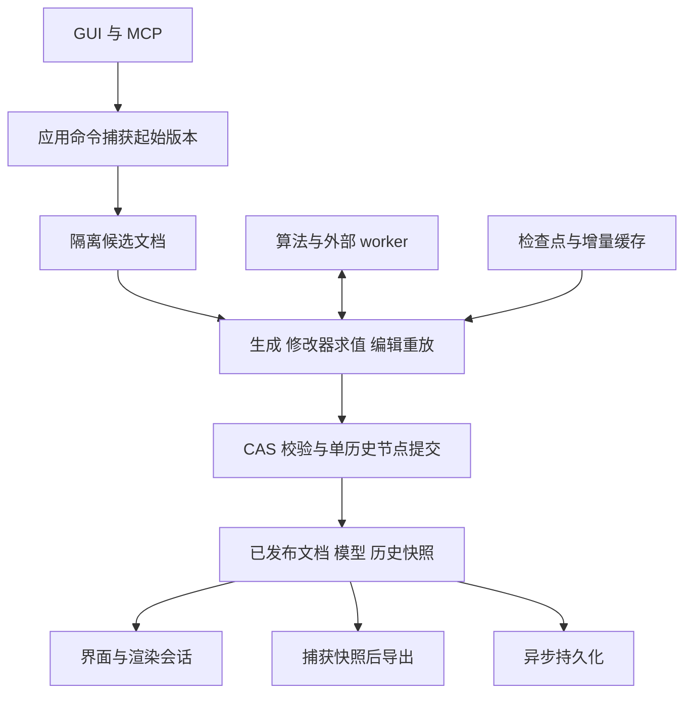

# 架构与质量优化实施方案

[路线图](../ROADMAP.md) · [运行时与导出边界](RUNTIME_EXPORT_ARCHITECTURE_AND_GAPS.md) · [修改器栈](RIG_MODIFIER_STACK.md) · [插件迁移](MODIFIER_PLUGIN_MIGRATION.md)

状态：设计中。基线为 2026-11-14 的 `c9109773` 及当时工作区的架构审查；实施各项前应在实际起始提交复核对应行为。工作区中进行中的算法迁移不视为已验收能力。

本方案将近期缺陷修复、性能治理、依赖整理和编辑体验改进合并为一条实施路径：先恢复确定性与历史可重放性，再建立性能基线和缓存边界，随后收敛模块依赖与交互状态。沿用模块化单体，不引入远程服务或第二套工作区状态。

## 目标与完成条件

| 目标 | 完成条件 |
| --- | --- |
| 编辑与历史可靠 | 同一输入在冷执行、缓存命中、历史切换和重开后得到语义一致的结果；非法引用不进入已发布状态 |
| 性能可解释 | 能区分排队、重建、转换、通信、算法、编译与呈现开销，并说明缓存为何失效 |
| 内存有边界 | 可重算缓存有字节预算与释放入口；历史必需资源按引用保留，不被缓存淘汰规则删除 |
| 开发边界清楚 | 应用层编排、文档契约、算法执行与目标导出职责明确；禁止依赖由自动检查约束 |
| 交互反馈准确 | 草稿、已提交修订与磁盘保存状态可区分；连续编辑只产生一次历史提交 |

本方案不调整自动绑定的艺术目标，不一次性重写所有模型表示，不批量改写旧工程或历史 ID。格式变更、算法效果变化和结构重构分别交付，避免在同一提交中混合验证。

## 现有架构与保留约束

| 层 | 组成 | 当前职责 |
| --- | --- | --- |
| 入口 | Compose UI、MCP、CLI | 交互、协议和启动参数适配 |
| 应用 | `application` | 工作区生命周期、候选编辑、命令、任务与会话编排 |
| 文档与历史 | `project`、`history` | 文档、journal、分支历史、归档与恢复 |
| 生成与重放 | `core` | 源输入处理、模型生成、修改器与编辑重放 |
| 算法 | `algorithm-api`、`algorithm-worker`、`algorithms/*` | 中立契约、worker 协议和算法实现 |
| 引擎 | `umamo` | 模型、求值、编辑原语与渲染 |
| 表示与导出 | `format-model`、`format-compile`、`targets/*` | RigIR、目标降级、损失报告与写出 |

产品的 `application/core/project/history/ui` 目前是根模块内的包边界；算法、引擎和导出已有 Gradle 模块边界。后续拆模块以消除循环依赖为前提。

以 [WorkspaceRuntime](../../../src/main/kotlin/io/github/psd2live/application/WorkspaceRuntime.kt) 为唯一工作区权威。昂贵计算在运行时状态锁外完成，候选成功后核对版本并提交；无变化不增加历史。批量后续成员必须能读取前序候选模型，失败或提交前取消不得发布前缀。CAS 成功后的刷新失败或迟到取消不得被报告成编辑回滚。

读取、渲染和导出沿用捕获快照。草稿和实时播放帧不成为持久文档的第二份副本。内存提交成功与磁盘保存成功分别表达。

沿用已有检查点、追加重放、修改器前缀缓存、读取集合缓存、二进制增量通信和延迟编译。优化这些机制的契约与生命周期，保留 Cubism 预览与导出复用同一次编译结果的约束。

## 第一阶段 修复正确性并建立回归

### 缺陷清单

以下是审查基线上的问题，不代表已经修复。前三项优先于结构调整；字段修复可独立交付，缓存内存项先补观测再验证回收策略。

| 编号 | 问题与证据强度 | 实施入口 | 修复与验收 |
| --- | --- | --- | --- |
| F1 | 同 ID、同版本、不同 digest 的内置包替换会删除旧归档；已用合成包复现旧 digest 无法继续解析 | `ModifierPluginStore` 的包归档与替换路径 | 新旧内容同时保留，默认选择与历史解析分离；更新后旧工程及历史分支仍能解析原 digest |
| F2 | 网格拆分删除旧网格后，遮罩和 Glue 引用未完整迁移；合成遮罩及 Glue 用例在输出校验失败，纹理来源引用也需纳入覆盖 | `MeshSplitAlgorithm` | 对受影响引用逐类定义迁移；不能无损处理的情况在候选阶段拒绝并给诊断，不得静默丢失 |
| F3 | 读取缓存命中与冷执行未经过相同的参数同步路径；静态确认路径差异，端到端复现曾被插件初始化依赖阻断 | `RigModifierEvaluator` | 以最小独立插件隔离复现，再统一规范化与校验；参数顺序、树、引用及变化判定一致 |
| F4 | worker 几何对象与字节数组由强引用映射保留，缺少预算淘汰；尚无长时内存实测 | `ModifierPluginWorkers` | 增加字节记账和可控释放；连续编辑、取消、关闭与重开场景下缓存占用有界 |
| F5 | 眉眼联动控件写入 `lid`，算法配置使用 `lidCoupling`；静态确认 | `ModifierStackPanel` 与配置定义 | 控件使用规范键；验证点击、撤销、重做、重开与算法输入一致，并明确旧错误键的兼容读取策略 |

源码入口：[包存储](../../../src/main/kotlin/io/github/psd2live/core/modifier/ModifierPluginStore.kt)、[拆分算法](../../../algorithms/binding/src/main/kotlin/io/github/psd2live/algorithms/binding/MeshSplitAlgorithm.kt)、[求值器](../../../src/main/kotlin/io/github/psd2live/core/modifier/RigModifierEvaluator.kt)、[worker](../../../src/main/kotlin/io/github/psd2live/core/modifier/ModifierPluginWorkers.kt)、[修改器面板](../../../src/main/kotlin/io/github/psd2live/ui/views/ModifierStackPanel.kt)。

### 统一结果处理

进程内算法、外部 worker、读取缓存命中和普通执行均进入同一语义处理链：解码并检查载荷 → 核对前置状态与写入范围 → 应用变更 → 规范化派生结构 → 校验引用与结构 → 形成可缓存结果。规范化不能用删除非法引用的方式掩盖错误。校验失败保留原已发布快照。

先收敛现有 `ModifierModelChanges` 与校验入口，不引入新的通用插件框架。缓存必须说明保存的是原始变更还是规范化结果，避免命中时漏处理或重复处理。

网格替换需要覆盖组织树、遮罩、Glue、纹理来源、关键形、混合形、路径、顶点组与生成结果覆盖。拆分映射应由一个明确结果携带，相关引用迁移复用该映射。无法确定 Glue 顶点归属时给出稳定错误码和对象引用，禁止仅为了通过校验而删除 Glue。

### 插件身份与保留规则

包 digest 标识不可变内容；包版本、算法版本、协议版本和配置版本分别管理。安装新版只改变新建实例的默认选择，已有精确 digest 引用仍解析原内容。缺少锁定包时提示恢复原包，不静默改用最新版。

现有历史内置版本兼容映射单独建立清单和测试。已有精确内容锁定优先；未锁定旧记录沿用经验证的兼容行为，不能把版本收敛等同于内容等价。若需改变旧记录语义，提供显式转换并形成可撤销编辑，不在读取时改写历史。

第一阶段禁止自动清理旧包。后续清理必须覆盖所有已知持久历史分支、检查点、活动会话和任务；外部未打开工程无法完整枚举时，保守保留，或通过用户明确操作清理并说明影响。算法归档和必要检查点不能套用普通 LRU 淘汰。

## 第二阶段 性能测量与缓存治理

### 建立基线

为一次操作关联任务、起始修订和候选构建标识，分阶段记录排队、生成、重放、模型转换、worker 编解码与传输、算法执行、目标编译、首次正确呈现的耗时。记录网格与顶点规模、缓存命中与失效原因、传输字节、缓存保留字节和进程内存。

使用可公开的合成夹具建立小、中、大三档场景，覆盖首次导入、单字段编辑、拓扑编辑、栈重排、撤销重做、保存重开和目标导出。固定输入、硬件、JDK、插件内容及目标选项，区分冷启动和预热后执行；至少采集 30 次交互样本，记录中位数、P95 和异常值，长任务另记单次组成。

此阶段先形成基线再设具体延迟预算，不预先承诺倍数收益。内存检查采用预热后至少 1,000 次编辑与多次开关工程的开发工具；同时检查缓存字节计数、保留对象和工作区关闭后的释放，不用一次 GC 后的堆大小单独判定泄漏。

### 明确构建阶段与失效传播

在 [WorkspacePreviewBuilder](../../../src/main/kotlin/io/github/psd2live/application/WorkspacePreviewBuilder.kt) 和现有生成器依赖图上引入内部构建计划，描述源像素、拓扑、绑定与参数、修改器、图集、目标产物之间的真实依赖。阶段输入包括相关配置、资源内容、目标选项与锁定插件身份；读写关系不明确时保守失效。

第一批只选一个局部配置编辑和一个拓扑编辑场景接入。每条快路径输出失效原因，并与关闭缓存的执行进行差分验证，再扩展其他路径。保留修改器栈的语义顺序，不为并行或缓存命中改变顺序。

批量编辑只有在后续成员不读取中间模型时才允许延迟计算；其余继续逐候选重建。实时预览可取消过期请求，正式编辑继续按版本和队列顺序提交。

### 分离模型快照与缓存所有权

| 数据 | 所有者与释放方式 |
| --- | --- |
| 文档、journal、历史必需对象 | 工作区与持久化存储；按可达性和保存契约管理 |
| 不可变求值结果 | 已发布快照和活动读取会话；读者释放后允许回收 |
| 候选构建的可变工作区 | 单次构建；完成、失败或取消时释放 |
| 可重算几何与序列化缓存 | worker 或构建缓存服务；按字节预算淘汰，提供关闭入口 |
| 目标编译产物 | 按求值修订、目标版本、编译选项及相关算法身份索引；按需生成 |

逐步将 [RigPreviewModel](../../../src/main/kotlin/io/github/psd2live/core/Model.kt) 上的可变构建缓存移入明确所有者。共享仅限不可变条目；淘汰不能使活动请求正在使用的字节失效。进程共享 worker 采用租约或引用计数，关闭一个工程不得终止其他工程仍使用的进程。

对 `PuppetModel ↔ RigIR`、worker 便携视图和字节载荷分别计量，优先消除同一修订中的重复转换。新增 Rust 内核或更复杂并行调度须由端到端剖析支持，并保留确定性对照验证。

## 第三阶段 收敛契约与模块边界

### 产品层依赖

先消除 `PSD2LivePipeline → CliPresetBindings` 的反向调用：CLI 预设装配由应用层完成，生成层接受已经明确的输入或窄策略。对 `project ↔ core` 逐项分类，把稳定文档值类型和编辑记录与生成实现分开，把归档读写留在持久化实现中。

目标依赖方向为：UI/MCP/CLI 适配器 → 应用编排 → 文档契约及生成接口；生成实现和持久化实现共同依赖文档契约，互不调用对方的实现。文档契约不依赖应用、UI、存储服务或生成器。

先扩展 [LayerDependencyTest](../../../src/test/kotlin/io/github/psd2live/application/LayerDependencyTest.kt)，记录存量例外并禁止新增；每消除一处例外即收紧规则。待候选边界无循环后再拆 Gradle 模块。移动源码时保留序列化名称、记录顺序和确定性 ID。

### 通用模型转换与目标导出

将 [PuppetIr](../../../targets/cubism/src/main/kotlin/io/github/psd2live/targets/cubism/PuppetIr.kt) 的通用双向转换提取为 GPL 模块，暂称 `umamo-ir-bridge`。该模块依赖引擎与中立 IR，供算法和 Cubism target 使用；Cubism target 保留目标降级、编译与写出。先证明转换本身无目标编译依赖，再迁移调用方。

`format-model`、`format-compile` 和 `algorithm-api` 保持各自的中立契约与许可证边界，不将 GPL 实现复制到 MIT 模块。字段转换用合成全字段模型验证双向保留；导出路径迁移使用既有黄金工具对比，遵守工程对 CMO3 GUID 的例外约定。

### 配置与操作定义

参照 [WorkspaceOperationDefinition](../../../src/main/kotlin/io/github/psd2live/application/WorkspaceOperationRegistry.kt)，集中定义插件配置键、类型、默认值、取值范围、能力与配置版本。序列化协议与 journal 仍保留 JSON；边界解析后转换为内部类型，减少字符串键在 UI、适配器和算法中的重复维护。

通用控件读取同一描述，复杂画布交互保留专用编辑器。能力、schema、实际接受字段和四种语言文案键通过契约检查保持一致；自动生成只承担确定的重复部分。

## 第四阶段 开发组织与 UX

### 按会话和功能组织控制器

沿 [WorkspacePorts](../../../src/main/kotlin/io/github/psd2live/application/WorkspacePorts.kt) 的窄接口，依次抽出修改器、素材、画布手势、时间轴和工作区生命周期控制器。每次只迁移一个领域的命令适配与临时状态，视图继续从已发布快照派生数据。

`WorkspaceHost` 保留装配和生命周期职责，领域流程交给现有命令与会话。`PSD2LiveViewModel` 逐步保留投影与控制器组合。文件行数不作为验收目标；验收关注新增功能是否能局限于对应领域、是否还需要同步修改多份状态。

先梳理共享缓存和会话线程约束，再评估缩短 `editMutex` 的范围。不能仅因锁覆盖耗时操作就直接移除串行保护。

### 用户可见行为

| 场景 | 目标体验 | 验收 |
| --- | --- | --- |
| 拖动或连续输入 | 草稿立即响应，过期预览可取消，手势结束提交一次 | 单次手势一个历史节点；冲突和取消不留下半成品 |
| 正式后台编辑 | 展示实际阶段与可取消状态；结束后跳转到已提交版本 | 提交前取消无变化；提交后刷新失败不提示编辑已回滚 |
| 自动保存 | 使用持久化协调器区分正在保存、已保存与失败；重试不生成重复编辑 | 保存完成版本落后于当前修订时不能显示全部已保存 |
| 修改器配置 | 明确作用对象、依赖缺失、版本问题及禁用原因 | 无效配置给稳定诊断；控件值与算法输入一致 |
| 导出 | 展示目标版本与损失摘要；导出针对明确捕获修订 | 后续编辑不改变进行中的导出输入 |

状态说明使用面向用户的措辞；digest、缓存键和失效细节放在诊断展开项。复用现有 DCC 令牌、Compact 控件、浮层、快捷键和提示，不引入第二套视觉规范。界面验收覆盖主题、缩放、四种语言、键盘焦点与取消操作；UI 变更附截图，动效变更附录屏。

## 交付拆分与依赖

每项以聚焦提交或 PR 交付。下表是依赖顺序，不承诺日历排期；每项实施前先复核当前源码，避免重复修复其他工作已完成的内容。

| 交付 | 范围 | 前置 | 放行条件 |
| --- | --- | --- | --- |
| A1 | F1 包内容保留与解析 | 无 | 同版本不同内容并存；历史 digest 可恢复 |
| A2 | F2 拆分引用迁移 | 无 | 遮罩、Glue 等关系合法；不支持情况原子拒绝 |
| A3 | F3 统一结果处理 | 无 | 冷热执行及进程内/worker 语义一致 |
| A4 | F5 控件键与配置契约 | 无 | UI 到算法及保存恢复一致 |
| B1 | 性能与内存基线 | 可与 A 项交错推进 | 场景可复现，分阶段数据完整 |
| B2 | F4 缓存预算、释放与快照拆分 | A3、B1 | 有界缓存、活动读者安全、关闭可释放 |
| B3 | 两类编辑的构建计划试点 | A2、A3、B1 | 失效可解释，差分一致，收益可测 |
| C1 | 反向依赖清理与自动约束 | A 项完成 | 禁止新增循环，历史格式保持兼容 |
| C2 | GPL 通用转换模块 | B1、C1 的边界梳理 | 字段往返与导出对比通过 |
| D1 | 控制器试点和状态反馈 | A4、B2 | 单一状态权威，保存及取消语义准确 |
| D2 | 扩展迁移与清理旧入口 | 前述试点验收 | 各领域完整工作流通过后逐项删除旧实现 |

优先完成 A1–A4；不让模块拆分成为修复正确性问题的前置条件。

## 验证与退出条件

日常回归采用小型合成模型与临时目录，按相关测试类执行；不依赖真实用户插件目录、端口或设置。较大变更提交前运行全量测试。整模型冷重放、长时内存和视觉检查放进受 `PSD2LIVE_TOOLS=1` 控制的开发工具，避免拖慢常规测试。

| 变更类别 | 必须覆盖 |
| --- | --- |
| 插件与缓存 | 冷热结果、进程内/worker、相关输入变化失效、无关输入保留、取消与异常 |
| 结构编辑 | 合法引用、稳定 ID、参数与组织顺序、失败原子性、批量中间读取 |
| 持久化相关 | 保存重开、旧格式、分支历史、必要检查点、精确包引用缺失与恢复 |
| 转换与导出 | 字段往返、目标能力和损失报告、导出读回、黄金对比及视觉检查 |
| UI 与会话 | 单手势单历史、草稿冲突、保存失败、关闭释放、主题与多语言 |

比较模型语义时覆盖参数顺序、对象身份、引用、通道和资源，不只比较网格顶点。浮点容差按字段与既有算法约定确定，不能扩大容差来掩盖结构变化。性能优化同时报告正确性、时间与内存；若主张收益不成立或出现显著退化，应缩小或撤回优化实现。

运行时实现回滚与历史数据兼容分别处理。尚未迁移完成的路径通过内部选择保留旧实现；撤回新执行路径不删除新旧包、不重写历史。旧入口只在调用方迁移、回归和导出验收完成后移除。

## 文档维护

本方案只记录内部实施设计；现行文档、工程格式和插件协议仍以对应规范为准。涉及规范变化时，在实现交付中同步对应规范，避免以计划文字替代实际契约。

完成后的证据进入 `STATUS.md`，已完成计划按仓库约定归档。公开插件行为、用户操作或 MCP 契约变化时同步中文与英文相应文档；纯内部实现说明保留中文。记录实测时区分单元回归、端到端、性能和视觉验收，不将其中一种通过等同于全部完成。
