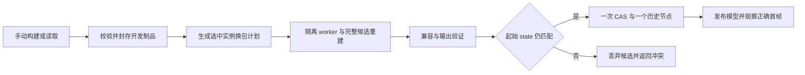

# 修改器代码手动重载、安装与卸载方案

状态：**设计中，尚未实现**。调研日期：2026-11-14；源码基线：`b6308c98`，另有进行中的修改器 UI 工作区改动。本文依据源码静态检查与官方资料提出实施方案，未执行构建、运行实验或新能力验收。UI 位置描述是操作语义，不固定到本轮在途面板布局。

目标是：修改算法代码后，手动点击“构建并应用”，在**不重启主程序**的情况下看到当前模型的新效果，并能撤销、保存、重开和导出。建议复用现有包摘要与独立 worker，补齐“不可变开发制品 → 隔离候选求值 → 选中实例换包 → 一次工程提交”。普通预编译包的安装、启用、禁用和卸载已经有 UI/MCP 入口；缺少的是开发代码构建及可撤销的实例换包闭环。开发迭代自动生成修订，不要求每次手改版本号。首期仅支持既有宿主契约下的活动修改器实例，不做文件监听、宿主 UI 代码热替换或已烘焙内容的自动重新生成。

## 1. 现有包管理可复用，代码应用事务需要补齐

| 能力 | 源码现状 | 本方案补齐 |
| --- | --- | --- |
| 安装预编译代码包 | 设置页与 `plugin_install` 共用服务，接受包/目录/Git 来源；不执行安装或构建脚本，无需重启宿主 | 保持现有入口与正式包不可变规则 |
| 启用、禁用、卸载 | UI/MCP 已有；内置包可启停、不可卸载；卸载保留工程实例 | 开发来源移除与代码归档清理分别呈现 |
| 更新实例配置 | `modifier_update` 只改同一代码身份的配置 | 新增专用重绑原语，保留原有身份校验 |
| 修改代码后应用 | 没有源码构建、候选修订、实例换包的完整入口 | 受控构建、兼容计划、选中范围原子应用 |
| 加载算法实现 | 当前标准内置引用走宿主进程内定义；显式不同引用可走 worker | 开发修订显式走 worker，不覆盖宿主已加载的类 |
| 历史与工程锁 | 实例及已应用能力记录保存精确插件引用，依赖也有摘要锁 | 开发制品持久保留，重放不读源码目录的最新文件 |

包管理入口见 [WorkspacePluginOperations.kt](../../../src/main/kotlin/io/github/psd2live/application/WorkspacePluginOperations.kt)（8–20、92–133）及 [SettingsPluginsSection.kt](../../../src/main/kotlin/io/github/psd2live/ui/components/SettingsPluginsSection.kt)；普通配置更新和领域约束分别见 [WorkspaceModifierEdits.kt](../../../src/main/kotlin/io/github/psd2live/application/WorkspaceModifierEdits.kt)（42–48）、[RigModifierStack.kt](../../../src/main/kotlin/io/github/psd2live/core/modifier/RigModifierStack.kt)（59–66）。现行安装说明见 [算法插件指南](../guide/ALGORITHM_PLUGINS.md)。以上是源码能力判断，不代表本次重新实测了各入口。

两个接点决定了不能只增加“重新读取”按钮。第一，[RigModifierAlgorithms.kt](../../../src/main/kotlin/io/github/psd2live/core/modifier/RigModifierAlgorithms.kt)（25–40）仍选择当前标准内置的进程内实现，磁盘 JAR 改变不会更新已加载类。第二，普通安装增加全局 store revision，各 [WorkspaceHost](../../../src/main/kotlin/io/github/psd2live/application/WorkspaceHost.kt)（1895–1910）据此 `refreshModel`；该刷新不写工程历史。因此，先全局安装候选、再尝试换实例，会在正式提交前影响其他工程的刷新与解析。

构建粒度也不等于应用粒度。[binding 构建](../../../algorithms/binding/build.gradle.kts)（219–270）为多种逻辑修改器生成共享 `runtime.jar`；改一处实现可能改变多个包的摘要。界面应显示实际构建模块与产物集合，但默认只切换用户选中的实例。下游需要重放，不代表其代码包必须升级。

## 2. 采用 worker 代际切换，限定热更新边界

| 方案 | 能力与代价 | 选择 |
| --- | --- | --- |
| 标准 JVM HotSwap / Instrumentation | 可替换方法体，但存在类结构限制；活动栈仍执行旧字节码，静态状态不会重新初始化 | 可作开发调试手段，不作为产品承诺 |
| 新 ClassLoader / PF4J | 可载入新实现与私有依赖，但要清理旧对象、线程、订阅和缓存引用 | 暂不引入第二套进程内插件生命周期 |
| 新 worker 代际 | 新进程加载新代码，旧进程可并存；需要启动、通信和候选重放成本 | **采用，复用项目已有协议与存储** |

JDK 21 标准重定义禁止增删字段、方法及改变签名、继承等结构；已有活动栈和静态状态也不会自动重置。上述限制来自 [JVM TI RedefineClasses](https://docs.oracle.com/en/java/javase/21/docs/specs/jvmti.html#RedefineClasses) 与 [Instrumentation](https://docs.oracle.com/en/java/javase/21/docs/api/java.instrument/java/lang/instrument/Instrumentation.html)。`URLClassLoader.close()` 不使已加载类失效，类卸载还依赖定义它的 loader 可被回收；见 [URLClassLoader.close](https://docs.oracle.com/en/java/javase/21/docs/api/java.base/java/net/URLClassLoader.html#close())、[JLS 12.7](https://docs.oracle.com/javase/specs/jls/se21/html/jls-12.html#jls-12.7)。这些是选择进程边界的依据，不是本项目的性能实验结果。

[PF4J](https://pf4j.org/doc/class-loading.html) 提供插件独立类加载器及[生命周期](https://pf4j.org/doc/plugin-lifecycle.html)，但仍受 JVM 引用关系约束；成熟的 [IntelliJ 动态插件机制](https://plugins.jetbrains.com/docs/intellij/dynamic-plugins.html) 也要求清理资源，并存在卸载失败后需要重启的情况。本项目已有 worker，无须为了获得安装/卸载接口再引入 PF4J。

| 代码变化 | 首期处理 |
| --- | --- |
| worker 内算法、辅助类、私有依赖、资源，包括增删内部方法或字段 | 契约兼容时构建新修订并应用 |
| 参数值计算变化，参数 schema 和输出身份约定保持兼容 | 保留配置及用户覆盖，验证后应用 |
| 配置 schema、输出对象 ID 或算法契约版本变化，需要迁移 | 阻断并报告需迁移；确定性迁移另立后续工作 |
| 宿主捕获 adapter、新编辑原语、宿主 Compose UI/MCP 实现 | 需要宿主更新；普通算法包重载不覆盖这些代码 |
| algorithm-api / worker 协议、宿主原生库或渲染 ABI 不兼容变化 | 返回需升级/重启宿主的诊断 |
| 完全封装在 worker 内的私有原生库 | 可按代际更新，但须单独验证退出和文件释放 |

首期用宿主契约指纹保守校验；它覆盖协议、API 数据结构和实际 capture adapter 能力，不能仅比较包语义版本。所有被支持的开发 profile 必须验证内置引用转 worker 后确实使用新实现；不能把一个示例插件成功推广成全部修改器已支持。算法契约继续留在 MIT `algorithm-api`，不得引入产品、Umamo、UI 或历史依赖。

## 3. 开发修订与文档事务共同保证可重放

### 3.1 自动修订不进入默认包选择

保留稳定包 ID、算法 type 和算法契约版本。受控打包器从源文件的基础版本生成 `<base>+dev.<buildId>`，已有 build metadata 时按语法追加开发段；不回写受跟踪的版本文件。`buildId` 由最终 manifest 之前的规范化执行负载、资源、兼容清单与依赖锁指纹生成，随后计算完整包 digest，避免“版本包含最终包摘要、包摘要又包含版本”的循环。相同输入复用制品；截短显示值不作为完整身份，摘要碰撞或同完整版本异内容仍拒绝。

工程使用既有完整引用 `{id, version, digest, dependencyDigests}`，不持久化 `latest`。现有 [ModifierPluginVersions.kt](../../../algorithm-api/src/main/kotlin/io/github/psd2live/core/modifier/ModifierPluginVersions.kt)（17–23、36–40）接受 build metadata，但版本比较及 range `exact` 忽略它；开发构建不能仅靠 `exact: 1.0.0+dev.x` 锁定。完整引用和实际文件摘要才是执行身份。普通第三方同 ID、同完整版本、不同内容的安装拒绝规则保持不变，见 [ModifierPluginStore.kt](../../../src/main/kotlin/io/github/psd2live/core/modifier/ModifierPluginStore.kt)（243–279）。

新增独立开发制品索引与来源归属，开发包不进入普通 `defaultPackages`、无锁依赖的最高版本选择或正式包冲突集合。它们仅在明确选取开发修订、精确引用解析及候选执行中可见。不能只加 `+dev` 后塞入全局 catalog：[ModifierPluginDependencies.kt](../../../src/main/kotlin/io/github/psd2live/core/modifier/ModifierPluginDependencies.kt)（22–28）的无锁选择还会比较原始版本字符串和 digest。也不应更换包 ID 来绕开规则，否则会遇到算法 type 所有权冲突。

开发来源注册保存本机路径、模式、受控 profile、允许构建的目标包。注册不自动添加模型实例，也不自动更新工程。开发包构建完成后，可从明确标识的“开发修订”列表选择精确引用，通过现有 `modifier_add` 新增实例；该路径需接入相同的归档解析和提交前保留逻辑，不改变普通新增的默认包选择。

### 3.2 构建产物先封存，再供候选使用

`managed_build` 使用宿主已知 profile，限定工作目录、Gradle task、允许的参数和产物布局；MCP 不接受任意 shell 命令。普通 `plugin_install` 继续只读预编译包，不执行包内脚本。`built_package` 只重新读取完成的产物，UI 必须如实命名，不能称为编译源码。开发构建会执行本机项目构建逻辑，注册时须明确这一行为；进程隔离不等于权限沙箱。

按来源串行构建，输出写入本次任务独立目录；完整产物清单及摘要校验完成后才发布 artifact。profile 记录声明输入的前后指纹；输入或输出在构建期间发生可检测变化时，候选作废重试。P0 不将 Git 提交号或源码时间戳当作内容证明，实际应用身份以封存的可执行字节为准；严格源码快照构建可后续补充。仅改 manifest 且执行负载相同可以复用编译制品，但候选执行仍按 3.4 隔离代际，不能复用旧进程的可变状态。

存储分为“未采用候选”和“已被工程采用的不可变归档”。匿名、未采用候选有任务/计划租约与 TTL，失去租约且过期后可清除；提交前把目标制品及完整依赖闭包持久落盘，成功后登记工程和历史引用。CAS 失败允许留下未引用归档，但不发布工程状态。P0 保守保留已采用归档，不适用候选 TTL，也不做自动清理；这使源目录被移动、删除或再次修改后，同机撤销、重做、重开仍能执行确切版本。

工程文件目前保存引用不能等同于携带所有第三方执行字节。**首期承诺同机持久开发仓库重开**；跨机器须另行导入精确制品，缺失时明确报缺包。可分享工程不写入本机源码绝对路径；跨机携包、许可证和供应链策略独立设计，不打包专有 SDK。

### 3.3 换包是独立文档编辑，范围必须明确

新增领域 `rebind` 原语及应用层代码更新命令，保留普通 `update` 的身份限制。重绑保持实例 ID、type、算法契约版本、targets、config、enabled、outputAliases、parameterProviders、顺序及用户覆盖，只更换兼容的精确包引用。计划验证 requires/provides、读写范围、exclusiveFamily、composableKinds、参数 schema、输出 ID 约定和下游作者编辑；缺少迁移或出现孤立覆盖时阻断，不能静默恢复默认配置。

首期范围固定为当前工程选中的活动实例。计划分开列出“换包实例”“必须一起换包的依赖实例”“只需重新求值的下游实例”；第二类扩展须明确选择，不能静默扩大到全工程。其他工程及未选中且仍兼容的实例保留旧引用。已应用前缀的 `appliedCapabilities` 保留旧算法身份，不能改写成新修订冒充重新生成；用户应回到应用前历史再更新。现状见 [RigModifierEvaluator.kt](../../../src/main/kotlin/io/github/psd2live/core/modifier/RigModifierEvaluator.kt)（453–471）。



构建与计划不改文档。计划 token 由服务端生成，绑定 project、state、history node、revision、实例旧引用、新 artifact 与完整依赖锁、宿主契约及基础 catalog 版本，附过期时间。应用不能相信客户端回传的可编辑计划 JSON。执行前重验 token 和制品，锁外完整重建/重放，最后检查取消与 state，再按现有 [WorkspaceRuntime](../../../src/main/kotlin/io/github/psd2live/application/WorkspaceRuntime.kt)（278–308）的提交边界完成一次 CAS 和一个历史节点。

同一完整引用重复应用为 no-op；新引用即使当前画面恰巧相同，仍是需记录的代码变更。普通撤销恢复旧引用，重做恢复新引用，历史读取不改写旧 ID 或包锁。所有文档更新走中立应用层，GUI 与 MCP 不直接修改包 store 后调用 `refreshModel` 代替事务。

### 3.4 解析、缓存、进程和呈现分别管理

将冻结的 package resolver/catalog snapshot 显式传入 registry、evaluator、preview builder 和 worker 路径，候选 overlay 包含本次精确开发制品。不能借用 `archiveOnly` 或“临时全局注册再删除”冒充私有候选。开发制品存储变化不递增全局活动目录 revision；正式目录确实发生变化时，陈旧计划返回冲突。P0 完整重建候选，不复用可能携带旧算法结果的前缀缓存；后续再以精确引用、依赖闭包、宿主契约与上下文指纹证明增量复用。

现有 [ModifierPluginWorkers.kt](../../../src/main/kotlin/io/github/psd2live/core/modifier/ModifierPluginWorkers.kt)（38–58）以路径、协议、命令、files 与依赖锁池化，未按算法 type 或完整 manifest digest 隔离。同一共享 JAR 可服务多个实例，仅增加候选租约不能保证独立进程。**P0 必须为每次需执行的候选分配独立 execution generation**，扩展池 key 或采用等效独立会话池；即使只改 manifest、执行负载相同，也不复用旧代际的静态状态或其他可变执行状态。只有相同完整引用且文档不变的 no-op 可以跳过候选执行。

不在构建开始时 stop/uninstall 旧包。候选成功提交后，新的运行时实例、读会话和导出持有者绑定该代际；旧模型、旧读者及其他工程继续持有旧代际，最后持有者释放后异步退役。代际是进程运行身份，不写入确定性模型对象 ID；重开依精确制品重新建立代际。重复候选的失败、超时或取消仅退出本次代际，从而使故障隔离真正成立。面向用户的“强制重启同字节代码”可后续增加，不能用现有 `stop(reference)` 冒充实例级重启。

编译、握手、依赖、输出验证失败及 CAS 前取消均保持旧文档、历史、绑定和模型；只释放本次候选资源。编译超时终止该请求拥有的构建进程，不杀共享 Gradle daemon 或其他 JVM；worker 超时只处置候选代际。最后取消检查到 committed 记账之间不能有挂起点。CAS 后迟到取消、预览或清理异常不得改写已提交事实；返回独立呈现/清理状态。进程终止需观察退出结果，不能将 `destroyForcibly()` 返回视为已经退出，见 [Java Process](https://docs.oracle.com/en/java/javase/21/docs/api/java.base/java/lang/Process.html)。

“已应用”表示文档已提交；“已显示”还需匹配 project/state/revision 的正确帧。复用 [WorkspaceEditObservation.kt](../../../src/main/kotlin/io/github/psd2live/application/WorkspaceEditObservation.kt) 与[首帧测量边界](../guide/FIRST_CORRECT_FRAME_MEASUREMENT.md)，不能以任意重绘或窗口激活替代。无窗口 MCP 返回 `not_applicable`；渲染失败返回“已应用，但预览显示失败”，恢复旧版本走普通撤销。

## 4. UI 与 MCP 使用同一工作流，卸载不混淆四种对象

### 4.1 UI 让一次手动操作完成常规迭代

设置中的“开发来源”展示来源、构建 profile、最近成功修订和日志，提供“添加开发来源”“构建代码”“移除开发来源”。普通预编译包继续使用既有安装页。新增实例时，开发修订是显式选择项；注册或构建成功不自动向模型插入修改器。

选中活动修改器后提供“更新代码…”，显示当前修订、目标来源与适用范围。正常兼容且只涉及选中范围时，主操作“构建并应用到选中实例”直接串联构建、计划、应用；预构建模式为“重新读取并应用”。只有计划扩大换包范围或需要用户决策时才展示具体变更供选择，不在每次成功路径插入泛化确认。显示实际需要构建的共享模块，避免暗示每个修改器都独立编译。

进度依次显示“正在构建”“正在检查兼容性”“正在重建模型”“正在应用”“已应用，等待显示”“已显示”，提供取消与日志入口。编译诊断尽可能定位文件/行号；错误须说明“尚未应用”或“已应用，但预览显示失败”。构建期间画布和面板可操作；若用户编辑导致 state 改变，提示重新计划，不自动覆盖新编辑。需要减少此类冲突时，可先单独构建，再对最新状态发起应用。

界面复用现有 Compact/Modal/Panel 组件、主题与动效令牌，四种语言补齐键，快捷键进入统一注册表；开发状态不另起一套视觉规范。实现阶段对齐届时的修改器面板布局，而非覆盖本轮正在进行的 UI 改动。

### 4.2 拟议 MCP 契约与 UI 共用应用服务

**下表及示例均为设计中的新增接口，不是当前可调用 API。** 使用现有任务 envelope、`job_get` / `job_wait` / `job_cancel`；读计划可异步执行但不写文档。所有输入、结果和 jobResult 均声明严格 schema，未知字段拒绝，错误用 `WorkspaceFailure` 类型归类。

| 操作 | 范围 / 类型 | 请求核心字段 | 结果核心字段 |
| --- | --- | --- | --- |
| `plugin_dev_list` | 本机配置与制品 / 只读查询 | 可选 `source_id` | `sources, artifacts`，含来源状态、制品摘要与完整包引用 |
| `plugin_dev_register` | 本机配置 / job | `source, mode, profile_id, request_id` | `source_id, mode, profile_id, package_ids` |
| `plugin_dev_build` | 本机制品 / job | `source_id, request_id` | `artifact_id, packages, build_digest, unchanged, diagnostics, log_ref` |
| `modifier_code_plan` | 当前工程 / 只读 job | `state, artifact_id, instance_ids` | `plan_token, expires_at, state, changes, dependency_changes, replayed_instance_ids, blockers, warnings, can_apply` |
| `modifier_code_apply` | 当前工程 / 文档 job | `state, plan_token, request_id` | `applied, project_id, state_before, state, revision, history_node_id, changes, observation, presentation` |
| `plugin_dev_detach` | 本机配置 / job | `source_id, request_id` | `detached, source_id, retained_artifact_ids` |

`mode` 为 `managed_build` 或 `built_package`，schema 按模式约束 `profile_id`：前者必填并在注册白名单内，后者为 null；禁止自由 task/shell 字符串。`packages` 和变更项的 `old_ref/new_ref` 使用完整引用结构；变更项包含 instance ID、算法 type，P0 `config_migration` 固定为 `none`。诊断为 `{code,severity,message,instance_ids,package_ids,details}`，`details` 按 code 定义 union，不用任意 JSON 隐藏不稳定契约。

`plugin_dev_list` 使客户端重连后可重新发现 `source_id` 与可用 `artifact_id`，而非依赖丢失的旧任务结果。来源项包含 `source_id, mode, profile_id, status`；制品项包含 `artifact_id, source_id, build_digest, packages, retention, expires_at`，其中完整包引用用于精确选择，`retention` 区分 `candidate|adopted`。已移除来源的保留制品仍可列出；未采用候选过期后不再可选，已采用归档的 `expires_at` 为 null，不因客户端断线或来源移除而消失。清单详情复用既有 `plugin_inspect` 的精确开发引用解析，不另建一组详情接口。

`presentation` 固定为 `{status, frame_id}`，状态为 `pending|displayed|failed|not_applicable`，frame ID 可为 null；`observation` 使用既有编辑观测的严格映射。应用 job 的 committed 结果不可被后续帧状态覆盖，呈现进展通过现有观察机制关联。相同 `request_id` 和输入返回原任务/结果，异输入复用返回 `request_id_reused`，避免网络重试产生第二个历史节点。

以下 `operation/arguments` 仅说明调用顺序，最终 transport envelope 依现有注册器实现；示例 ID 为占位值。

```json
{"operation":"plugin_dev_list","arguments":{}}
{"operation":"plugin_dev_register","arguments":{"source":"D:/work/algorithm-dev","mode":"managed_build","profile_id":"binding-dev","request_id":"register-01"}}
{"operation":"plugin_dev_build","arguments":{"source_id":"dev-01","request_id":"build-02"}}
```

等待构建 job 完成，取得 `artifact_id`，再读取当前工程 state 和明确选择的实例 ID：

```json
{"operation":"modifier_code_plan","arguments":{"state":"s42","artifact_id":"artifact:a1b2c3","instance_ids":["modifier-17"]}}
{"operation":"modifier_code_apply","arguments":{"state":"s42","plan_token":"plan:7f8e","request_id":"apply-02"}}
```

等待 plan job 完成且 `can_apply=true` 后才发送 apply。若期间 state 改变，返回 `state_conflict`；重新计划需产生新 token。`job_wait` 等待超时只返回当前任务状态，与构建/worker 执行超时区分。新增稳定错误码包括 `dev_source_missing`、`build_failed`、`build_timeout`、`artifact_changed`、`artifact_missing`、`plugin_api_incompatible`、`plugin_config_incompatible`、`plugin_dependency_incompatible`、`plan_expired`、`plugin_worker_failed`、`plugin_worker_timeout`；取消沿用任务终态，不解析本地化消息作判断。

### 4.3 安装与卸载分别作用于来源、可用性、实例和文件

| 用户动作 | 行为 | 工程 / 历史影响 |
| --- | --- | --- |
| 安装普通代码包 | 既有安装器读取预编译包，提供可选实现 | 不自动添加实例，不自动改旧实例的精确引用 |
| 注册开发来源、构建开发包 | 准备构建入口或不可变候选 | 不改变当前模型；显式新增或应用后才进入文档 |
| 移除开发来源 | 移除后续构建入口 | 已有实例及历史继续使用已归档制品 |
| 禁用代码 / 卸载普通包 | 既有全局可用性操作，影响使用者与依赖 | 保留实例/config；缺包或禁用时明确阻断相关求值/导出，精确重装可恢复 |
| 删除修改器实例 | 当前工程普通文档命令 | 重放并验证依赖，产生可撤销历史；不删除旧代码归档 |
| 物理清理开发归档 | 独立维护动作，P0 不提供自动清理 | 删除确切字节后相关旧历史/离线工程可能缺包；不得静默替换成其他修订 |

开发来源的“移除”不是彻底删除代码；UI 应直接说明保留历史所需制品。若需停止某个当前实例，优先使用实例启停命令；若需全局禁用代码，明确列出已知受影响工程及依赖。主程序内置代码无法在运行中从宿主 JVM 物理卸载，现有内置包仍不提供卸载操作。

后续归档清理应检查当前与打开工程、全部历史分支、`appliedCapabilities`、包依赖及读者/导出/候选租约。该索引不能证明所有磁盘离线工程均无引用；P0 默认保留，不以“扫描完打开工程”宣称安全清空。显式破坏性清理若后续开放，应报告已知引用和未知范围，并沿用缺包、精确重装恢复机制；不能做成每个实例旁的普通卸载按钮。全局可用性操作的影响也不能用一个工程的 state CAS 伪装成全局事务。

## 5. 分期按可用闭环验收，再优化构建与重放

### 5.1 实施顺序与并行边界

| 阶段 | 交付与主要归属 | 退出条件 |
| --- | --- | --- |
| P0.1 身份与候选基础 | 开发制品索引/归档、自动版本、依赖锁、私有 resolver、worker 代际及租约；`core/modifier` 与受控打包任务 | 同基础版本的新实现可并存，默认目录不变，旧引用仍可执行，候选失败不刷新其他工程 |
| P0.2 文档应用事务 | `rebind`、兼容计划、独立候选构建、CAS、一节点历史、精确引用新增实例；`application`、持久化接点 | 选中范围正确；撤销/重开/导出一致；失败和取消无半提交 |
| P0.3 UI/MCP 开发闭环 | 至少一个支持现有内置修改器的 `binding-dev` 受控 profile、来源注册、构建应用、日志、移除来源、严格公开 schema | UI 与 MCP 均完成真实源码 A→B→A，宿主 PID 不变，正确画面和持久化证据齐全 |
| P1 按需求扩展 | 更多 profile、显式配置/输出迁移、源码快照构建、会话预览、归档导入/清理、经证明的增量重放 | 每项独立验收，不回头放松 P0 的身份与原子性约束 |

先冻结身份、resolver、计划与结果契约；随后包存储/worker与应用事务可按接口并行，UI/MCP 以同一应用服务接入，构建 profile 与生命周期工具可独立推进。P0.1 是 P0.2 的依赖，P0.3 的真实集成依赖前两项；只支持外部编译后读取可以作为中间里程碑，不能据此宣称“构建并应用”已交付。自动归档回收、任意 schema 迁移和全部修改器覆盖不作为 P0 阻塞项。

### 5.2 验收覆盖真实代码与正确首帧

| 场景 | 必须观察到的结果 |
| --- | --- |
| 真代码 A→B，含内部类结构变化 | 实际构建并执行 B，输出可辨识改变；宿主 PID 不变，新执行负载使用新 worker；不能只改 manifest 或用 stub |
| 普通包安装→新增→禁用→启用→卸载→精确重装 | UI/MCP 行为一致，无需重启；实例与配置保留，受影响导出明确受阻，重装恢复 |
| 开发注册→构建→新增/应用→移除来源 | 注册不新增实例；新实例/换包均锁定精确引用；移除来源后仍能重放 |
| 共享 binding JAR、选中范围及依赖闭包 | 构建产物集合可大于换包集合；未选择且兼容的实例与其他工程仍使用 A |
| 历史、保存重开与导出读回 | A→B→撤销 A→重做 B；移动源目录后同机重开各分支；目标格式读回实际反映对应算法及画面 |
| 已应用前缀、配置或输出身份不兼容 | 明确拒绝或提示回到旧历史；不改 `appliedCapabilities`，不清空用户配置和覆盖 |
| 编译、摘要、API、依赖、worker、输出失败 | 旧 state/history/model 不变；错误机读；候选可释放，旧读者/导出继续正常 |
| 取消、超时、CAS 竞争和重复请求 | 提交前零变更，提交后仍报告 applied；陈旧计划冲突；重试不重复历史节点 |
| UI/MCP 与精确首帧 | 两入口同一事务；通过编辑 observation、state/revision、渲染 receipt 与像素证据确认 B 的首个正确帧 |
| 多工程、同负载新 manifest 与连续更新资源 | 候选仍使用独立代际；取消/超时不影响旧进程及租约；无持续进程/句柄/临时目录累积；清理失败不回滚已提交工程 |
| MCP 重连与候选生命周期 | list 重新取得来源和可用制品 ID；未采用候选按 TTL 过期，已采用归档及精确引用持续可发现 |
| 缺包与保留边界 | 缺精确制品明确报错，重装恢复；不误删历史所需归档，不宣称索引覆盖未知离线工程 |
| DCC 交互与语言 | 构建不阻塞画布；选择、参数、视口不无故跳变；主题、缩放、四语言与已有面板一致 |

领域/事务测试验证不变式，真实 worker、窗口、保存重开及导出读回另做定向集成工具；重型性能与出图验收保持工具模式，不能把完整工作负载塞进日常单元测试。实现阶段按仓库规则执行相关回归，较大改动合并前跑全量测试；本次纯文档任务不运行这些测试。

### 5.3 性能目标以完整开发循环实测确定

记录从用户手动提交修改到正确显示的各段：构建配置、增量编译、封包/摘要、worker 启动/握手、候选重建/重放、CAS、模型发布到正确帧；同时记录峰值内存、存活进程与连续更新后的资源数。分别测冷构建、方法体、结构、资源与依赖变化，标明模块/实例数量及工程规模。首次采用新 worker 的开销与后续同修订重放分开报告，不能用“包读取很快”代替用户等待时间。

优先缩小 task 范围，避免每次 `clean`、全应用打包和无关测试；声明准确的输入输出，先用项目现有增量与 Build Cache。Kotlin 增量编译、Gradle up-to-date 和 Configuration Cache 分别解决不同阶段，见 [Kotlin 编译缓存](https://kotlinlang.org/docs/gradle-compilation-and-caches.html)、[Gradle 增量构建](https://docs.gradle.org/current/userguide/incremental_build.html)、[Configuration Cache](https://docs.gradle.org/current/userguide/configuration_cache.html)。

当前 [gradle.properties](../../../gradle.properties) 已开启 Build Cache，但主动禁用 daemon、使用 Kotlin in-process，目的是避免中断后累积后台进程。只在受控开发 profile 中实测 [Gradle daemon](https://docs.gradle.org/current/userguide/gradle_daemon.html) 的收益与退出管理，不默认翻转全局配置。官方 current 文档与仓库固定 Gradle 版本存在差异，缓存兼容性必须在项目固定版本验证。

本次未获得新开发循环的延迟数据，因此不承诺毫秒级或固定秒数。硬门槛先定为主程序不重启、目标代码确实执行、状态可重放、失败保留旧模型、UI 可响应且资源不持续累积；时延预算在 P0.1 的代表性基线后制定。最有价值的首批交付是一个完整、可靠、可撤销的开发循环，再按测量结果决定优先优化编译、worker 启动、重放还是图集/显示。

外部官方资料检索日期均为 2026-11-14；源码行号仅对应本次审计快照。后续实现改变公开 MCP/用户功能时，再同步中英文使用文档与实际 schema；本方案不将拟议命令提前写入现行 API 参考。
